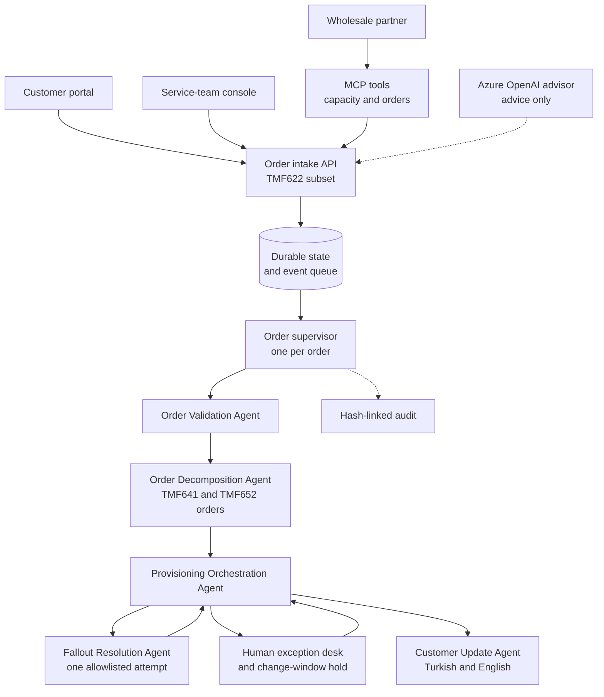

# TürkBizTel | Agentic order-to-activation

A working, synthetic-data demonstrator for **AMA Case Study 30: agentic B2B order-to-activation for a Turkish telecommunications operator**, presented under the **TürkBizTel** brand. It follows dedicated Internet, managed SD-WAN and cloud-connect orders from a customer or a wholesale partner through to activation, with one supervisor per order and five specialist AI agents.

*Status as of 24 November 2026.*

> **This is not** a live carrier integration, a TM Forum-certified API or a KVKK/BTK-compliant production system. The network, CRM, inventory and partner adapters are labelled simulators, and the deployed demonstrator holds synthetic data only. The Azure OpenAI advisor is real, but it has no authority to execute anything.

## Start here

**Separate isolated-agent acceptance copy:** [architecture and provisioning runbook](docs/ISOLATED-AGENTS.md).

**Latest Foundry edition:** [six hosted agents](docs/FOUNDRY-AGENTS.md) and
[a separate app with Microsoft SSO plus service-engineer token login](docs/FOUNDRY-SSO-APP.md).
The new app preserves the UI and copies the Foundry app's data once into its own private state store.
It deploys five independently authenticated workers plus a dispatch-only supervisor and trusted policy boundary
into a new `rg-amai-*` stack. Existing Azure applications are not upgraded or retired.
Agent 365 is an optional, separately authorized governance integration, not an enabled feature.

Follow the end-to-end journey: **1) Today → 2) Architecture → 3) Solution → 4) Live App Demo → 5) Live App**.
The recorded demo and the interactive app are separate chapters. The links below point to the current published editions.

| What | Where |
|---|---|
| Assignment: AMA Assignment 30 – Haider Raza | [Assignment PDF](https://github.com/m-haider-raza/AMA-Telecom-Order-to-Activation/blob/main/AMA_Assignment30_HaiderRaza.pdf) |
| GitHub repository | [AMA Telecom Order-to-Activation](https://github.com/m-haider-raza/AMA-Telecom-Order-to-Activation) |
| Latest six-hosted-agent Foundry app: Microsoft SSO and engineer access token | [Service-team sign-in](https://amai-boundary-qwc6ymcrjozog.mangosand-20d8d735.swedencentral.azurecontainerapps.io/login#staff) or [case study](https://amai-boundary-qwc6ymcrjozog.mangosand-20d8d735.swedencentral.azurecontainerapps.io/case-study) |
| Interactive solution story, with the latest videos, target deck and working demonstrator | [Start the story](https://amai-boundary-qwc6ymcrjozog.mangosand-20d8d735.swedencentral.azurecontainerapps.io/case-study) |
| Current-state film (1:51) | [current-scenario.mp4](https://amai-boundary-qwc6ymcrjozog.mangosand-20d8d735.swedencentral.azurecontainerapps.io/static/current-scenario.mp4) |
| Solution film (2:56) | [solution-tower-v6.mp4](https://amai-boundary-qwc6ymcrjozog.mangosand-20d8d735.swedencentral.azurecontainerapps.io/static/solution-tower-v6.mp4) |
| Login-to-activation highlights (2:28), then try it live | [Live App Demo chapter](https://amai-boundary-qwc6ymcrjozog.mangosand-20d8d735.swedencentral.azurecontainerapps.io/case-study#/demo), then [Live App](https://amai-boundary-qwc6ymcrjozog.mangosand-20d8d735.swedencentral.azurecontainerapps.io/case-study#/app), or [MP4](https://amai-boundary-qwc6ymcrjozog.mangosand-20d8d735.swedencentral.azurecontainerapps.io/static/app-walkthrough.mp4) |
| Shared customer and partner sign-in, with a staff SSO/token option | [Sign in](https://amai-boundary-qwc6ymcrjozog.mangosand-20d8d735.swedencentral.azurecontainerapps.io/login) or [interactive Live App chapter](https://amai-boundary-qwc6ymcrjozog.mangosand-20d8d735.swedencentral.azurecontainerapps.io/case-study#/app) |
| Earlier complete app tour (5:13), natural-paced George narration | [MP4](https://amai-boundary-qwc6ymcrjozog.mangosand-20d8d735.swedencentral.azurecontainerapps.io/static/app-walkthrough-full.mp4) or [transcript](https://amai-boundary-qwc6ymcrjozog.mangosand-20d8d735.swedencentral.azurecontainerapps.io/static/app-walkthrough-full-transcript.txt) |
| Target architecture deck (19 slides, integrated governance and localisation) | [PowerPoint](https://amai-boundary-qwc6ymcrjozog.mangosand-20d8d735.swedencentral.azurecontainerapps.io/static/case-study/Agentic_Order_to_Activation_Architecture.pptx) or [PDF](https://amai-boundary-qwc6ymcrjozog.mangosand-20d8d735.swedencentral.azurecontainerapps.io/static/case-study/Agentic_Order_to_Activation_Architecture.pdf) |
| Foundry agents, model selection and cost per order | [PowerPoint](https://amai-boundary-qwc6ymcrjozog.mangosand-20d8d735.swedencentral.azurecontainerapps.io/static/case-study/TurkBizTel-Foundry-Model-Economics.pptx) or [PDF](https://amai-boundary-qwc6ymcrjozog.mangosand-20d8d735.swedencentral.azurecontainerapps.io/static/case-study/TurkBizTel-Foundry-Model-Economics.pdf) |
| Market-research slides | [PowerPoint](https://amai-boundary-qwc6ymcrjozog.mangosand-20d8d735.swedencentral.azurecontainerapps.io/static/case-study/research/AMA_O2A_Research_Slides.pptx) or [PDF](https://amai-boundary-qwc6ymcrjozog.mangosand-20d8d735.swedencentral.azurecontainerapps.io/static/case-study/research/AMA_O2A_Research_Slides.pdf) |
| Assignment brief | [PDF](https://amai-boundary-qwc6ymcrjozog.mangosand-20d8d735.swedencentral.azurecontainerapps.io/static/case-study/AMA_Assignment30_HaiderRaza.pdf) |
| Standalone service-team Microsoft SSO app | [Sign in](https://ama30-private-nbfy3ijurs3j2.lemonwave-c45cdea3.swedencentral.azurecontainerapps.io/login#staff) or [case study](https://ama30-private-nbfy3ijurs3j2.lemonwave-c45cdea3.swedencentral.azurecontainerapps.io/case-study) |
| Azure architecture as deployed | [docs/azure-architecture.md](docs/azure-architecture.md) |
| What the application does and how to use it, page by page | [docs/APPLICATION-GUIDE.md](docs/APPLICATION-GUIDE.md) |
| Residency release gate, gap list and runbook | [docs/PRODUCTION.md](docs/PRODUCTION.md) |
| Latest videos, architecture previews, decks, research and guides | [Current artefact bundle](https://amai-boundary-qwc6ymcrjozog.mangosand-20d8d735.swedencentral.azurecontainerapps.io/static/case-study/TurkBizTel-Case-Study-2026-11-24.zip) or [24 November release](https://github.com/m-haider-raza/AMA-Telecom-Order-to-Activation/releases/tag/turkbiztel-case-study-2026-11-24) |
| Original 22 November films, captions, transcripts, decks, research and guides | [Archived artefact bundle](https://ama30-private-zm5qigrnxeyay.wittywater-4a8731b1.swedencentral.azurecontainerapps.io/static/case-study/TurkBizTel-Case-Study-2026-11-22.zip); use the links above for the revised admin film and target deck |

The current interactive story runs on the Foundry app in Azure Container Apps in Sweden Central. Customers and partners share email/password sign-in; staff can use **Microsoft Entra ID single sign-on** with named roles or the engineer access-token fallback with operator permissions. Enterprise approval is required before work starts on staff-created requests. Older token-only and standalone SSO deployments remain separate historical editions. See [docs/STAFF-SSO.md](docs/STAFF-SSO.md).

The latest Foundry app above offers **both** staff sign-in options and uses all six real hosted agents.
Its complete source-data snapshot is independent of the older apps. See the
[Foundry dual-login runbook](docs/FOUNDRY-SSO-APP.md); the earlier optional prompt-advisor edition remains separate.

## What's new in this update

- **Sign-in and capacity fixes included.** The active Foundry app opens shared sign-in rather than mistaking a signed-out visitor for an expired staff session, including inside the story. Partner capacity checks show readable product, available-unit and change-window rows with explicit failure messages. The complete bundle also includes the Foundry agents/model-economics deck and the current dual-login runbook.
- **One current interactive story and download.** The 24 November edition combines the latest current-state and solution films, the 19-slide governed target-architecture deck with matching previews, and the 2:28 app walkthrough including the corrected "Inspect AI agent workspaces" narration. The downloadable bundle and SHA-256 manifest are rebuilt from those same assets with `python scripts/Publish_Case_Study.py`; earlier bundles remain archived.
- **Login-to-activation live app demo (2:28).** Step 4 opens on the shared `/login` page for customers and partners, then follows **Staff sign in** to Microsoft SSO and access-token options. It retains customer service selection/preferences and approval, partner deliveries/payments/concerns, and customer activation tracking and updates. Service administration remains about two thirds of the film: enterprise orders, partner setup, exceptions, agent workspaces, Analytics and audit. Detailed admin queue, billing and benchmark segments are omitted to stay below 2:30 without speeding up. The same George narrator speaks at normal speed, with captions below the app and seven chapter jumps. Public sign-in screens are captured from the live app without entering credentials; workflows are recorded locally with synthetic fixtures and a test staff session, not Microsoft sign-in, hosted inference or carrier execution. Step 5 remains the interactive app; the earlier full 5:13 tour remains available.
- **Orders placed for an enterprise, approved by the enterprise.** In the single sign-on build, **New order** now lists every enterprise in the database instead of one demo company. A service engineer picks one and places the order on its behalf. The enterprise's point of contact is e-mailed a personal link, and no agent starts until they approve, from the e-mail or from their own account. They can decline, and the service team can send the e-mail again or withdraw the request. Every step is recorded against the person who took it. [How it works](docs/STAFF-SSO.md#placing-an-order-for-an-enterprise).
- **Data copied across, once.** `scripts/Copy-AppData.ps1` copies what the access-token app holds into the single sign-on app: the enterprise accounts, the partners and their contacts, every order that has settled with its messages and history, the partner concerns and the audit trail. Enterprises and partner contacts keep their passwords. The two apps stay separate: it is a one-time snapshot, nothing is synchronised afterwards, and the access-token app is only read. [How it works](docs/STAFF-SSO.md#copying-the-data-from-the-token-mode-app).
- **Service-team single sign-on.** A new deployment mode replaces the shared access token with Microsoft Entra ID. Each person signs in with their own work account, an Entra app role (service manager, operator or auditor) decides what they can do, and the audit trail records who changed what on every order. It is a separate stack, so the existing app is unchanged, and customers still register and sign in with their own e-mail and password. [How it works and how to deploy it](docs/STAFF-SSO.md).
- **Azure architecture, as deployed.** [A new page](docs/azure-architecture.md) documents the 25-resource estate in Sweden Central: what each service is, how it was created, how traffic and identity flow, what is hardened and what is still open, and what it costs.
- **Solution film v6 (2:56).** Customers place orders, the supervisor wakes each agent in turn, TM Forum and MCP standards connect them, and the Azure Local design keeps customer data in Türkiye. Each AI agent is named in full once, then by its short name.
- **The deployed source is on `main`.** The customer and partner portals, accounts and staff sign-in, analytics, the Azure SQL store, the case-study site, the film build scripts and the tests are all in this repository, and the [application guide](docs/APPLICATION-GUIDE.md) describes them.
- **TürkBizTel branding** across the films, the deck and the app.
- **This README** is now a landing page. The Azure detail lives in `docs/`.

## Objectives

| Measure | Baseline | Target |
|---|---|---|
| Order-to-activation lead time | 35 days | Under 7 days |
| Orders that fall out into manual rework | 30% | Under 8% |

The assignment also sizes the prize at 12,000 orders a year, TRY 900 million of revenue acceleration and TRY 150 million of rework. These are the assignment's figures. They are targets to prove in an operational pilot, not results this demonstrator has measured.

How the solution goes after them:

- **Catch problems at the door.** Site, address, feasibility and inventory checks run before anything is allocated. A bad order pauses for customer correction instead of failing days later.
- **Hand each domain a precise job.** The product order is decomposed once into standard service and resource orders.
- **Recover without a ticket, within limits.** Known fallouts, such as a partner timeout, get one allowlisted recovery attempt. Anything riskier goes to a human exception desk.
- **Keep the customer informed** in Turkish and English at each milestone.
- **Stay auditable.** Every transition goes into a hash-linked audit trail, and a seven-day deadline stops overdue work for an audited review.

## How it works

A supervisor is created for every order and consumes one persisted event at a time. It wakes the specialist agents in lifecycle order:

| # | Agent | Wakes when | What it does | Guardrail |
|---|---|---|---|---|
| 1 | **Order supervisor** | An order is accepted | Supervises that one order and routes each event to the right specialist | Reserves capacity at most once. Enforces the deadline and change windows |
| 2 | **Order Validation Agent** | The first event | Checks the site and address, feasibility and inventory | Pauses for customer correction instead of guessing |
| 3 | **Order Decomposition Agent** | Validation passes | Splits the TMF622 product order into TMF641 service orders and TMF652 resource orders | Produces only the documented subset |
| 4 | **Provisioning Orchestration Agent** | Decomposition is done | Allocates capacity and activates through the simulated network, CRM, inventory and partner adapters | Holds for a closed change window or a route conflict before allocating |
| 5 | **Fallout Resolution Agent** | Provisioning stalls, for example on a partner timeout | Runs one allowlisted recovery, then hands back to provisioning | No arbitrary tools or shell. Anything else goes to the exception desk |
| 6 | **Customer Update Agent** | Services are activated. Milestones and holds queue messages along the way | Sends the closing Turkish and English update | SMS is not connected. The deployed build e-mails through Azure Communication Services |

These are the names in the application, its audit trail and the deck. The films use shorter names (Validation, Decomposition, Provisioning and Fallout Recovery) and introduce the supervisor as the Orchestration AI Agent.



The advisor is optional. It gives schema-validated advice and Turkish and English wording for an order. It cannot approve, execute or change anything, and a failure is shown as a failure, never disguised as live AI.

### Industry standards

| Standard | Used for | In this repository |
|---|---|---|
| TM Forum TMF622 Product Ordering | Order intake from the portal, partners and API | A simplified request and response subset. Not the full schema, and not certified |
| TM Forum TMF641 Service Ordering | Service orders produced by decomposition | A GET subset |
| TM Forum TMF652 Resource Order Management | Resource orders produced by decomposition | A GET subset |
| Model Context Protocol (MCP) | Lets wholesale partners and agents call capacity and order tools | `POST /mcp`: JSON-RPC over HTTP with `initialize`, `ping`, `tools/list` and `tools/call` |
| Target design | TM Forum Open APIs exposed as MCP tools through Azure API Management, with Microsoft Entra Agent ID for agent identity | Shown in the deck and the film. Not built here |

## Azure architecture


*Vector version: [azure-architecture.svg](docs/images/azure-architecture.svg).*

- **One resource group in Sweden Central.** An Azure Container Apps app (a single 0.25 vCPU replica) runs the portal, API, supervisor and agents in an environment integrated into a virtual network.
- **Data.** Azure SQL Database is the system of record, and a Blob container holds the legacy snapshot that seeds it. The app reaches both through private endpoints.
- **AI.** An Azure OpenAI deployment (`gpt-4.1-mini`) gives advice only and receives synthetic fields only.
- **Identity.** One user-assigned managed identity. No storage keys, registry admin user, SQL passwords or OpenAI keys.
- **Customer updates.** Azure Communication Services Email.
- **Operations.** Log Analytics, a US$100 monthly budget with alerts, and Microsoft Defender plans. About US$80 a month at list price, always on.
- **Open hardening items.** On 20 November the SQL server still had public network access enabled, with client-IP firewall rules added through the Azure portal, and SQL auditing was off. The app itself uses the private endpoint. Both items are in the [hardening checklist](docs/azure-architecture.md#hardening-checklist-for-any-use-beyond-a-demo).

[docs/azure-architecture.md](docs/azure-architecture.md) has the full resource inventory, the timeline of how each service was created, the runtime flow, the security checklist, the cost table and read-only commands to check the estate yourself.

## Data residency

The assignment requires customer data and inference to stay in Türkiye. Microsoft's public geography inventory, checked on 30 October 2026, lists no Azure region there. The deployed demonstrator therefore runs in **Sweden Central with synthetic data only**, and the application labels itself `productionCompliant: false`.

The production design keeps customer data and inference in Türkiye with **Azure Local** in an operator-owned or approved Turkish datacentre, and uses Azure services outside the country only where no customer data is involved:

- **Stays on Azure Local in Türkiye:** the portal and API, the supervisor and agents, the OSS/BSS adapters, the order database and event system, identity, secrets, logs and audit, backup and disaster recovery, and an approved local inference endpoint. Foreign Azure OpenAI stays off for customer payloads.
- **Azure outside Türkiye, with no customer data:** Azure Container Registry for approved container images, Azure Arc management metadata after an assessment of what leaves the country (disconnected operations is the alternative), and opt-in aggregate Azure Monitor metrics after a re-identification review.
- **Leaves Türkiye by default:** no customer payloads, prompts, raw logs or backups.

Encryption, private endpoints and EU hosting do not by themselves establish localisation, and legal counsel and the operator's data protection officer decide the actual KVKK and BTK obligations. See [Data residency in the Azure architecture](docs/azure-architecture.md#data-residency) and the residency section of [docs/PRODUCTION.md](docs/PRODUCTION.md).

## Requirements map

| Assignment requirement | Implemented surface |
|---|---|
| Validation, address, feasibility, inventory | `app/domain.py`: city, site and catalogue allowlists, and a customer-correction pause |
| L4 decomposition, TMF622/641 | Product order to service and resource orders. A documented TMF-inspired REST subset |
| L3 provisioning, change windows | Guarded supervisor. Explicit window and risk holds before allocation |
| L3 fallout resolution | One-attempt allowlisted partner-timeout recovery. No arbitrary shell or tool execution |
| Customer updates in Turkish and English | Persisted bilingual portal messages. The deployed build also sends e-mail through Azure Communication Services. SMS is not connected |
| Per-order event-driven supervision | Durable queued and processed events, atomic commits and idempotency keys |
| Partner integration through MCP | `/mcp`: initialization, discovery, capacity and order tools |
| Human service-manager queue | Exception desk. Decisions need a server-enforced manager role: the shared manager token, or a Microsoft Entra service-manager sign-in in the [single sign-on build](docs/STAFF-SSO.md) |
| Customer consent before work starts | In the single sign-on build an order a service engineer places for an enterprise waits for that enterprise's contact to approve it. No agent starts until then, staff cannot answer for the enterprise, and the answer is on the audit trail. See [Placing an order for an enterprise](docs/STAFF-SSO.md#placing-an-order-for-an-enterprise) |
| SLA enforcement | Seven-day demo deadline. Overdue work stops for an audited explicit review |
| Auditability | Hash-linked records, verification and an authorized CSV export. With single sign-on every staff change names the person, their role and the fields they altered. Not WORM storage and not a regulatory certification |
| Data and inference localization | Synthetic-only demo in Sweden Central, with an Azure Local design for Türkiye. See [Data residency](#data-residency) |
| Realistic industry data | Public CC0 Turkish city facts plus explicitly fictional customers, prices and capacity |

## Status

| Real | Simulated or not built |
|---|---|
| A deployed Azure estate in Sweden Central: private endpoints, managed identity, Azure SQL as the system of record, an Azure OpenAI advisor and Azure Communication Services e-mail | Network, CRM, inventory, field-service and partner adapters. Activating an order does not provision a real service |
| An event-driven supervisor with five agents, durable events, idempotency keys and a hash-linked audit trail | SMS delivery and any live carrier or OSS/BSS integration |
| A TMF-inspired REST subset and an MCP endpoint | TM Forum conformance, the full TMF schemas, filtering, pagination, hubs and callbacks |
| Schema-validated, advisory Azure OpenAI output | KVKK and BTK compliance, and the Türkiye-hosted Azure Local environment |

- **The agents are bounded.** In this demonstrator the five specialist agents are deterministic implementations built on rules, allowlists and playbooks. The Azure OpenAI advisor is the only model-backed part, and it cannot execute or approve.
- **The numbers are not results.** The Analytics view of the deployed build times synthetic orders against the 7-day and 8% targets. Those are simulator orchestration times from a scenario mix with a built-in 30% incident rate, so they show that the pipeline and the measurement work. They exclude partner field work and customer delays, and they are not evidence of production lead time, fallout or NPS. A representative pilot would provide that.
- **`main` holds the deployed source, but the template does not describe every deployed resource.** `app/`, `infra/` and `scripts/` are the code the demonstrator runs. The running SQL layer, the Communication Services e-mail resources and the two network security groups of the original deployment were created by direct CLI commands or by governance policy, so `scripts/Deploy.ps1` builds a close relative of the estate in [docs/azure-architecture.md](docs/azure-architecture.md), not a copy of it. (`-Live` now creates the e-mail resources from the template too, which is how the single sign-on stack gets them.) See [what the repository can and cannot reproduce](docs/azure-architecture.md#what-the-repository-can-and-cannot-reproduce).
- **Live mode and delivery are set on the app, not by the template, unless you deploy with `-Live`.** A template deployment runs in demo mode: `AMA_MODE` is unset, so the synthetic views are public and writes need a token, and customer updates stay in the portal. The original deployed demonstrator also sets `AMA_MODE=live` and `AMA_DELIVERY=live` directly on the Container App, together with `AMA_SESSION_SECRET` and the ACS settings. `-Live` sets those, the session secret and the e-mail resources from the template. With `AMA_DELIVERY=live` the app sends e-mail through Azure Communication Services (`ACS_CONNECTION_STRING`, `ACS_EMAIL_SENDER`) or an SMTP relay (`SMTP_HOST`, `SMTP_FROM`), and can post text messages to an HTTPS webhook (`AMA_SMS_WEBHOOK_URL`). The deployed build uses ACS e-mail only.

## Run it locally

This runs the code on `main`. It needs Python 3.12 or later, and 3.13 is recommended. In PowerShell:

```powershell
python -m venv .venv
.\.venv\Scripts\python.exe -m pip install -e ".[dev]"
powershell -File .\scripts\Start-Local.ps1
```

Open **http://localhost:8000**. The script generates independent manager and partner tokens into the git-ignored `demo-credentials.local.json`. Click **Demo access** and paste the appropriate token, or use **Staff sign in** with the manager token to stay signed in for eight hours. Do not enter an Azure password or a GitHub credential. Demo-access tokens stay in browser-tab memory, not browser storage, and the local server binds only to loopback.

If your organization's PowerShell policy requires signed scripts, follow that policy and do not disable it. You can also launch from any shell. Install the package, set distinct random `DEMO_ADMIN_TOKEN` and `DEMO_PARTNER_TOKEN` environment variables of at least 24 characters, and run:

```text
uvicorn app.main:app --host 127.0.0.1 --port 8000 --workers 1
```

`LOCAL_STATE_PATH` defaults to `data/state.json`. Restarting resumes queued orders and does not reseed or erase the snapshot. Interactive OpenAPI documentation is at `/docs`.

### Five-minute walkthrough

1. Open **Control tower**. Explain the five bounded agents and the synthetic-data and sovereignty banners. Four seeded orders show different paths.
2. Click **New order**, select **Partner timeout** and submit with a manager token. Open its drawer to see validation, decomposition, the timeout, one allowlisted recovery, provisioning and bilingual updates as durable transitions.
3. Create a **Route conflict** order. It stops before allocating network capacity. In **Exception desk**, approve or reject it as the service manager. A partner token cannot make that decision.
4. Create a **Closed change window** order. Release it only through an explicitly audited, *simulated* window approval. No production change window is bypassed.
5. Create an **Invalid site** order. The Order Validation Agent asks for customer correction. Confirm the fictional site reference to resume.
6. Use **Wholesale partners** with the partner token. Capacity checks and new orders go through the MCP HTTP endpoint, and partner orders face the same supervisor policies.
7. Open **Trust & governance** to inspect provenance and the hash-linked audit. Export the CSV with a manager token.
8. If Azure OpenAI is configured, request live advice from an order drawer.

On a single sign-on deployment, **New order** in steps 2 to 5 asks you to pick an enterprise. Its contact approves the order, from the e-mail or from their own account, before any agent starts. See [docs/STAFF-SSO.md](docs/STAFF-SSO.md#placing-an-order-for-an-enterprise).
## APIs and MCP

| Endpoint | Purpose and authorization |
|---|---|
| `GET /health` | Supervisor health |
| `GET /api/state` | The synthetic workspace. Public in demo mode (`AMA_MODE` unset), staff-only when `AMA_MODE=live`, as deployed |
| `POST /api/orders` | A manager or partner creates an idempotent synthetic order. With single sign-on, a service operator or manager |
| `GET /api/enterprises`, `POST /api/enterprises/{id}/orders` | Single sign-on build: a service operator or manager lists every enterprise and places an order for one. The order waits for that enterprise's contact, who is e-mailed. A staff session on `POST /api/orders` answers 409 and is pointed here |
| `POST /api/orders/{id}/approval/resend`, `POST /api/orders/{id}/approval/withdraw` | A service operator or manager sends the approval e-mail again (a new link; one a minute, five in all) or withdraws the request |
| `POST /api/approvals/check`, `POST /api/approvals/decide` | Public, with the signed token from the e-mail and an `X-Requested-With` header. Show the request, then approve or decline it. Throttled per address, and never answers 401 |
| `POST /api/me/orders/{id}/approval` | A signed-in customer approves or declines an order waiting for them |
| `POST /api/orders/{id}/decision` | Manager-only exception approve or reject |
| `POST /api/orders/{id}/address` | A manager or the submitting partner confirms a fictional site |
| `POST /api/orders/{id}/advice` | Manager-only live advice from Azure OpenAI, at most 30 attempts per UTC day. With single sign-on, a service operator or manager |
| `GET /api/audit` | Single sign-on only. The audit trail as JSON, with who made each change. Any service role |
| `GET /api/audit.csv` | Manager-only audit export. With single sign-on, any service role, and the columns include who made the change and what they changed |
| `GET /auth/sso/login`, `GET /auth/sso/callback`, `POST /api/auth/sso/handoff` | Single sign-on only. The Microsoft Entra sign-in for the service team, ending in a per-tab session |
| `/tmf-api/productOrderingManagement/v4/productOrder` | TMF622-inspired GET and POST subset |
| `/tmf-api/serviceOrdering/v4/serviceOrder` | TMF641-inspired service-order GET subset |
| `/tmf-api/resourceOrderManagement/v4/resourceOrder` | TMF652-inspired resource-order GET subset |
| `POST /mcp` | Authenticated, stateless Streamable HTTP JSON-RPC wrapper for partners |

The REST request is an intentionally simplified application DTO, **not the full TMF622 schema**. Filtering, pagination, hubs and callbacks, complete TMF schemas and conformance certification are not implemented. Read [docs/PRODUCTION.md](docs/PRODUCTION.md) before adapting a real OSS/BSS interface.

MCP supports `initialize`, `notifications/initialized`, `ping`, `tools/list` and `tools/call`. The tools are `check_partner_capacity` and `submit_partner_order`. Responses are JSON rather than SSE streams, and server-side sessions are not required. No provisioning or approval tool is exposed to the partner.

## Deploy to Azure

`scripts/Deploy.ps1` deploys `infra/main.bicep` into one brand-new resource group. With the options below it builds the core of the estate in [docs/azure-architecture.md](docs/azure-architecture.md): the private network, the SQL layer and the AI advisor. It creates the Communication Services e-mail resources only with `-Live`. See [what the repository can and cannot reproduce](docs/azure-architecture.md#what-the-repository-can-and-cannot-reproduce).

1. Run `az login`, then `az account list --all -o table`. Select an **Enabled** subscription. `-EnableSql` needs a **user** sign-in, because that account becomes the SQL Microsoft Entra administrator. `-StaffAuth sso` also needs a user sign-in that is allowed to register applications in the tenant.
2. Make sure the subscription has `Microsoft.App`, `Microsoft.Storage`, `Microsoft.ContainerRegistry`, `Microsoft.ManagedIdentity` and `Microsoft.OperationalInsights` registered, plus `Microsoft.Network` (private network), `Microsoft.Sql` (`-EnableSql`), `Microsoft.CognitiveServices` (AI), `Microsoft.Communication` (`-Live`) and `Microsoft.Consumption` (budget) if you use those options. Register providers only with the subscription owner's approval.
3. For AI, first confirm model availability and **regional Standard** quota in the target region. Do not switch to Global Standard to get around a regional constraint. The script defaults to `gpt-4.1-mini`, version `2025-04-14`, which is what the deployed estate runs. Models retire (`gpt-4o-mini` 2024-07-18 already has), so verify and override with a supported version.
4. Deploy with Azure CLI and Bicep. No local Docker is needed.

```powershell
powershell -File .\scripts\Deploy.ps1 `
  -SubscriptionId "<enabled-subscription-id>" `
  -ResourceGroup "rg-ama30-demo-<unique-suffix>" `
  -Location "swedencentral" `
  -EnableSql -EnableOpenAI
```

The resource group name must start with `rg-ama`. `-Location` is `westeurope` (the default), `swedencentral` or `northeurope`. Every option is optional:

| Option | What it adds |
|---|---|
| `-EnablePrivateStorage` | A virtual network with a Container Apps subnet and a private-endpoint subnet. The Container Apps environment joins it, and the storage account gets a private endpoint and private DNS and is closed to the public network |
| `-EnableSql` | Everything in `-EnablePrivateStorage`, plus an Azure SQL server that accepts Microsoft Entra sign-in only, the database `ama30-db`, a private endpoint with private DNS, and a one-off Container Apps job that creates the schema and the app's database user. The job deletes itself when it succeeds and is left in place for inspection when it fails |
| `-EnableOpenAI` | An Azure OpenAI account with key authentication off and a `telecom-advisor` deployment. Choose the model with `-OpenAiModel` and `-OpenAiModelVersion` |
| `-BudgetEmail "<address>"` | A budget with alerts at 80% actual and 100% forecast. Budgets use the subscription's billing currency, so adjust the Bicep amount for a US$100 target if it is not USD. Alerts are not hard caps |
| `-Live` | The production-style site: `AMA_MODE=live` and `AMA_DELIVERY=live`, a generated session secret, and an Azure Communication Services e-mail service with an Azure-managed domain, so customers register with their own account and receive their verification code |
| `-StaffAuth sso` | Service-team sign-in with Microsoft Entra ID instead of the shared access token. Needs `-Live`. Registers the Entra application. See [Single sign-on for the service team](#single-sign-on-for-the-service-team) |
| `-StaffManagers`, `-StaffOperators`, `-StaffAuditors` | User principal names to assign each service role. With none named, the signed-in user becomes the manager |
| `-StaffSessionHours <1-12>` | How long a service-team session lasts. The default is 4 |
| `-ReceiptPath "<file>"` | Where to write the deployment receipt. The default is `deployment.local.json`, or `deployment.sso.local.json` with `-StaffAuth sso`, so the original app's receipt is never replaced |
| `-CredentialsPath "<file>"` | Where to write the generated credentials. The default is `demo-credentials.local.json`, or `demo-credentials.sso.local.json` with `-StaffAuth sso`, in the repository root, which is git-ignored |

The script refuses an existing resource group or credentials file, always passes the explicit subscription, builds the image remotely in the registry with a unique tag, keeps deployment parameters secure and writes the generated credentials without printing them. It does **not** delete partially created resources after a failure. Inspect the tagged resource group, fix the cause and redeploy, or delete that exact group before a fresh run.

The core it deploys is a Container Apps consumption environment with one 0.25 vCPU / 0.5 GiB replica, a Basic registry, locally redundant Blob storage, a user-assigned managed identity with narrowly scoped roles and capped Log Analytics, plus the options above. Storage keys and registry admin access are off, and the app uses its managed identity. The app starts in demo mode: its web ingress is anonymously readable with synthetic demo data only, and writes need a demo bearer token.

The dedicated always-on replica runs the persisted supervisor while the browser is closed. Scaling to zero would strand queued work without a queue-based wake trigger, so scale-to-zero is deliberately not promised. Cost depends on running hours, builds, model prices and logs, and the US$100 a month target is not a quote. Check current [Container Apps](https://azure.microsoft.com/pricing/details/container-apps/), [Container Registry](https://azure.microsoft.com/pricing/details/container-registry/), [Blob storage](https://azure.microsoft.com/pricing/details/storage/blobs/) and [Azure OpenAI](https://azure.microsoft.com/pricing/details/cognitive-services/openai-service/) pricing.

### Single sign-on for the service team

The original app lets the service team in with one shared access token, so the audit trail cannot say which person changed an order. `-StaffAuth sso` deploys a **separate, standalone stack** where the service team signs in with Microsoft Entra ID instead, and the original app is left untouched:

```powershell
powershell -NoProfile -ExecutionPolicy Bypass -File .\scripts\Deploy.ps1 `
  -SubscriptionId "<enabled-subscription-id>" `
  -ResourceGroup "rg-ama30-sso" `
  -Location "swedencentral" `
  -EnablePrivateStorage -EnableOpenAI -Live `
  -StaffAuth sso -StaffManagers "person@contoso.com"
```

Where your organization allows it, `-ExecutionPolicy Bypass` runs the unsigned script. Otherwise follow its signing policy and do not disable it.

- **Registration.** `scripts/Register-StaffSso.ps1` creates a single-tenant Entra application with three app roles (`ServiceManager`, `ServiceOperator`, `ServiceAuditor`), an enterprise application (requiring assignment by default), and a federated credential for the app's managed identity. There is no client secret to store or rotate. It is safe to run again.
- **Approval.** Microsoft makes an administrator approve an app that requires assignment, once, or the sign-in stops at *Need admin approval*. Where no administrator is available, add `-StaffUserConsent` so each person approves for themselves. The app still refuses anyone without a role. See [Approving the app](docs/STAFF-SSO.md#approving-the-app).
- **Sign-in.** The OpenID Connect authorization-code flow with PKCE. The app checks the tenant, issuer, audience, expiry and role, and refuses a person who holds no role. The shared access token no longer opens any staff call.
- **Who did what.** Each change records the person's name, user principal name and role, and, for field edits, the old and new value. The console's audit trail filters by person, `GET /api/audit` returns the same data, and a second copy goes to the container log.
- **People.** Assign users or groups a role under **Enterprise applications > Users and groups** in the Microsoft Entra admin center. A removed person keeps access until their session expires.
- **Cost.** No Azure SQL, so roughly US$15 to 35 a month.

[docs/STAFF-SSO.md](docs/STAFF-SSO.md) has the roles, the sign-in flow, the settings, troubleshooting, the audit queries and the limits.

### Verify and clean up

```powershell
python -m pytest -q
python -m ruff check app tests
node --check .\app\static\app.js
az bicep build --file .\infra\main.bicep --stdout
python .\scripts\Smoke.py --credentials .\demo-credentials.local.json
```

CI (`.github/workflows/ci.yml`) runs `ruff check app tests`, `pytest -q`, `node --check` on every front-end script and on the two scripts in `scripts/film3d/`, and the Bicep compile. The smoke command needs the app running, for example from `Start-Local.ps1`, and reads its address and tokens from the credentials file. It creates one synthetic MCP order and verifies all five agents, bounded recovery, bilingual output and a denied partner approval.

To remove a deployment, confirm the exact dedicated resource group:

```powershell
powershell -File .\scripts\Remove-Demo.ps1 `
  -SubscriptionId "<subscription-id>" `
  -ResourceGroup "rg-ama30-demo-<suffix>" `
  -ConfirmResourceGroup "rg-ama30-demo-<suffix>"
```

The script checks the AMA demo tags and refuses unrelated groups. Run it only when you mean to delete that whole group and its data. The Entra application that `-StaffAuth sso` registers lives in the tenant, not the resource group, so deleting the group does not remove it. Add `-RemoveStaffSso` to delete it too, or run `scripts/Register-StaffSso.ps1 -Remove`.

## Repository map

| Path | Contents |
|---|---|
| `app/` | The FastAPI application. `main.py` is the app and `domain.py` the guarded simulation with the supervisor and agents. `auth.py`, `sso.py`, `security.py`, `accounts*.py`, `identity.py` and `delivery.py` cover sign-in (customer passwords, service-team tokens or Microsoft Entra single sign-on), role checks, customer accounts and e-mail. `approvals*.py` is the enterprise picker and the approval an enterprise gives before its order starts. `partners*.py` is the wholesale partner portal. `advisor.py` is the optional Azure OpenAI advice. `analytics.py` and `benchmark.py` measure order-to-delivery. `store.py` (JSON or Blob), `sqlstore.py`, `sqlwrite.py`, `sqlschema.py`, `sqlbootstrap.py` and `projection.py` keep state in Blob storage or Azure SQL |
| `app/static/` | The pages (landing, console, customer portal, partner portal, live demo, journey, solution players, case study), their scripts and styles, and the films, posters, captions and deck slides. Plain-named films such as `solution-tower-v6.mp4` are the source editions. The matching `*-turkbiztel.*` files are the TürkBizTel editions that `branded_static.py` serves under the plain names |
| `app/static/film3d-assets/` | Assets for the 3D film, with their licences and an `ATTRIBUTION.md` |
| `infra/main.bicep` | The Azure infrastructure |
| `scripts/` | `Deploy.ps1`, `Register-StaffSso.ps1` (the Entra registration for single sign-on), `Remove-Demo.ps1`, `Start-Local.ps1`, `Smoke.py` and `Verify_Demo.py` for the app. The film pipeline: the `Render_*.py` renderers, `Synthesize_*.py` narration, `Rebrand_Media.py`, `requirements-narrator.txt` and `film3d/`, whose scenes need Node.js |
| `tests/` | Twenty-two test modules covering the API, domain rules, accounts, partners, single sign-on and roles, enterprise approvals, analytics, the Blob and SQL stores, the case-study site and the films |
| `docs/` | The [application guide](docs/APPLICATION-GUIDE.md), the [service-team single sign-on guide](docs/STAFF-SSO.md), the [Azure architecture](docs/azure-architecture.md), [PRODUCTION.md](docs/PRODUCTION.md) and the diagrams in `docs/images/` |
| `Dockerfile`, `pyproject.toml` | The container image and the Python project metadata |
| `.github/workflows/ci.yml` | The quality workflow |
| `0-current-scenario.mp4`, `0-solution-tower-v2.mp4` | Film files at the root: the current-state film and an early solution-film edition. Newer editions are in `app/static/` and in the release |

## Security notes

- Keep secrets out of Git. `demo-credentials*.local.json`, `deployment*.local.json`, `.env` and local state are git-ignored.
- Share service-team access tokens out of band. Never commit them or paste them into slides, films or documents. The SSO-only edition has no shared staff token or client secret. The latest dual-login Foundry edition also uses secretless Microsoft sign-in, but keeps a separate private, operator-only onboarding token.
- Treat anything that has appeared in a document, a chat or Git history as exposed, even after the file is deleted, and rotate it. The deployed demonstrator's admin token and demo sign-ins were rotated on 20 November 2026.
- Do not enter an Azure or GitHub password into the application.
- The approval link e-mailed to an enterprise is a bearer credential for that one order. It is signed with the session secret, keeps its token after the `#` so servers and logs never see it, and only a `POST` can answer with it. Sending the e-mail again, or replacing the session secret, retires the old links. A service person can never answer for the enterprise.

## Reference data and licensing

City names and approximate coordinates reference Wikidata: [Istanbul (Q406)](https://www.wikidata.org/wiki/Q406), [Ankara (Q3640)](https://www.wikidata.org/wiki/Q3640) and [Izmir (Q35997)](https://www.wikidata.org/wiki/Q35997). Wikidata structured data is [CC0](https://www.wikidata.org/wiki/Wikidata:Licensing). Only these non-personal facts are included, and no real customer dataset is downloaded. The companies, sites, inventory, prices and telecom incidents are project-authored fixtures, not operator or subscriber records. The assignment PDF is not redistributed. The Azure diagram uses Microsoft Azure Architecture Icons (V25) under Microsoft's icon terms.

## Trademarks, logos and third-party assets

- **Operator marks.** The Turkcell, Türk Telekom and Vodafone Türkiye marks appear only to introduce the real Turkish telecom market, and Türk Telekom's public-domain geometric logo is used as industry context. The players link to each company's official website and to the source of its logo. The fictional case's challenges are not attributed to any of them. This project has no affiliation with, endorsement from, customer relationship with or live integration to those companies.
- **Microsoft.** The Azure diagram and the 3D film use Microsoft's Azure icons unchanged, under Microsoft's icon terms. Microsoft's trademark rights remain, and no Microsoft endorsement or partnership is claimed. The 3D people are Microsoft Rocketbox avatars (MIT licence).
- **Libraries.** The 3D film bundles three.js and fflate, both MIT. Their licence notices are in `app/static/film3d-assets/`, next to an `ATTRIBUTION.md`.
- **Narration.** All narration is synthetic. The current-state film and solution film v6 use the Kokoro `bm_george` preset voice (the Kokoro-82M weights are Apache-2.0, and the kokoro-onnx runtime is MIT). Some earlier editions use a locally cloned voice of the author, and their players say so. The voice sample itself is not in this repository.
