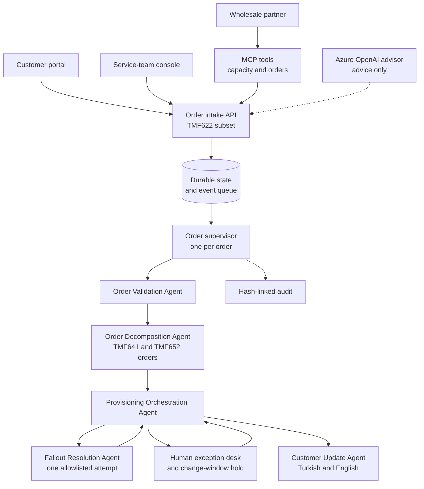
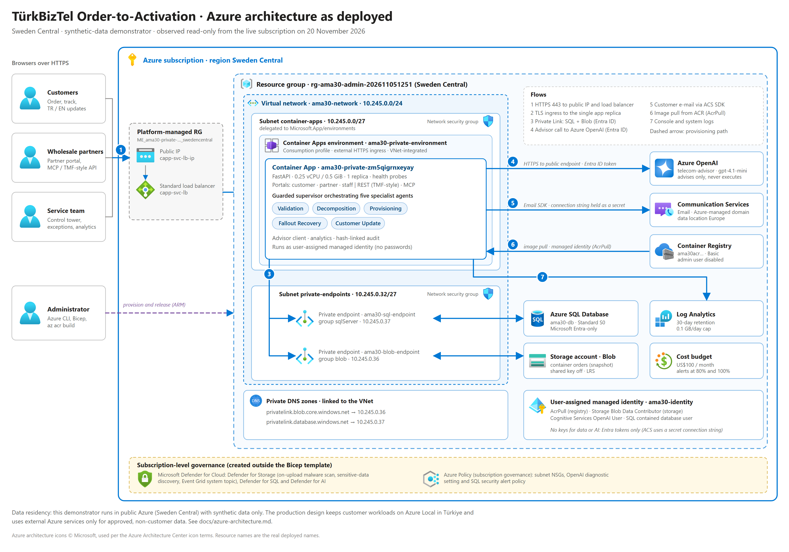

# TürkBizTel | Agentic order-to-activation

A working, synthetic-data demonstrator for **AMA Case Study 30: agentic B2B order-to-activation for a Turkish telecommunications operator**, presented under the **TürkBizTel** brand. It follows dedicated Internet, managed SD-WAN and cloud-connect orders from a customer or a wholesale partner through to activation, with one supervisor per order and five specialist AI agents.

*Status as of 20 November 2026.*

> **This is not** a live carrier integration, a TM Forum-certified API or a KVKK/BTK-compliant production system. The network, CRM, inventory and partner adapters are labelled simulators, and the deployed demonstrator holds synthetic data only. The Azure OpenAI advisor is real, but it has no authority to execute anything.

## Start here

| What | Where |
|---|---|
| Live case-study site, with the working demonstrator embedded | [case-study](https://ama30-private-zm5qigrnxeyay.wittywater-4a8731b1.swedencentral.azurecontainerapps.io/case-study) |
| Current-state film (1:51) | [current-scenario.mp4](https://ama30-private-zm5qigrnxeyay.wittywater-4a8731b1.swedencentral.azurecontainerapps.io/static/current-scenario.mp4) |
| Solution film (2:56) | [solution-tower-v6.mp4](https://ama30-private-zm5qigrnxeyay.wittywater-4a8731b1.swedencentral.azurecontainerapps.io/static/solution-tower-v6.mp4) |
| Architecture deck (14 slides) | [PowerPoint](https://ama30-private-zm5qigrnxeyay.wittywater-4a8731b1.swedencentral.azurecontainerapps.io/static/case-study/Agentic_Order_to_Activation_Architecture.pptx) or [PDF](https://ama30-private-zm5qigrnxeyay.wittywater-4a8731b1.swedencentral.azurecontainerapps.io/static/case-study/Agentic_Order_to_Activation_Architecture.pdf) |
| Azure architecture as deployed | [docs/azure-architecture.md](docs/azure-architecture.md) |
| Residency release gate, gap list and runbook | [docs/PRODUCTION.md](docs/PRODUCTION.md) |
| Every shareable asset in one release | [turkbiztel-case-study-2026-11-20](https://github.com/m-haider-raza/AMA-Telecom-Order-to-Activation/releases/tag/turkbiztel-case-study-2026-11-20) (this repository is private, so you need access) |

The live site runs on Azure Container Apps in Sweden Central. Its service-team console asks for an access token, which the service team shares out of band.

## What's new in this update

- **Azure architecture, as deployed.** [A new page](docs/azure-architecture.md) documents the 25-resource estate in Sweden Central: what each service is, how it was created, how traffic and identity flow, what is hardened and what is still open, and what it costs.
- **Solution film v6 (2:56).** Customers place orders, the supervisor wakes each agent in turn, TM Forum and MCP standards connect them, and the Azure Local design keeps customer data in Türkiye. Each AI agent is named in full once, then by its short name.
- **TürkBizTel branding** across the films, the deck and the app.
- **This README** is now a landing page. The Azure detail lives in `docs/`.

## Objectives

| Measure | Baseline | Target |
|---|---|---|
| Order-to-activation lead time | 35 days | Under 7 days |
| Orders that fall out into manual rework | 30% | Under 8% |

The assignment also sizes the prize at 12,000 orders a year, TRY 900 million of revenue acceleration and TRY 150 million of rework. These are the assignment's figures. They are targets to prove in an operational pilot, not results this demonstrator has measured.

How the solution goes after them:

- **Catch problems at the door.** Site, address, feasibility and inventory checks run before anything is allocated. A bad order pauses for customer correction instead of failing days later.
- **Hand each domain a precise job.** The product order is decomposed once into standard service and resource orders.
- **Recover without a ticket, within limits.** Known fallouts, such as a partner timeout, get one allowlisted recovery attempt. Anything riskier goes to a human exception desk.
- **Keep the customer informed** in Turkish and English at each milestone.
- **Stay auditable.** Every transition goes into a hash-linked audit trail, and a seven-day deadline stops overdue work for an audited review.

## How it works

A supervisor is created for every order and consumes one persisted event at a time. It wakes the specialist agents in lifecycle order:

| # | Agent | Wakes when | What it does | Guardrail |
|---|---|---|---|---|
| 1 | **Order supervisor** | An order is accepted | Supervises that one order and routes each event to the right specialist | Reserves capacity at most once. Enforces the deadline and change windows |
| 2 | **Order Validation Agent** | The first event | Checks the site and address, feasibility and inventory | Pauses for customer correction instead of guessing |
| 3 | **Order Decomposition Agent** | Validation passes | Splits the TMF622 product order into TMF641 service orders and TMF652 resource orders | Produces only the documented subset |
| 4 | **Provisioning Orchestration Agent** | Decomposition is done | Allocates capacity and activates through the simulated network, CRM, inventory and partner adapters | Holds for a closed change window or a route conflict before allocating |
| 5 | **Fallout Resolution Agent** | Provisioning stalls, for example on a partner timeout | Runs one allowlisted recovery, then hands back to provisioning | No arbitrary tools or shell. Anything else goes to the exception desk |
| 6 | **Customer Update Agent** | Services are activated. Milestones and holds queue messages along the way | Sends the closing Turkish and English update | SMS is not connected. The deployed build e-mails through Azure Communication Services |

These are the names in the application, its audit trail and the deck. The films use shorter names (Validation, Decomposition, Provisioning and Fallout Recovery) and introduce the supervisor as the Orchestration AI Agent.



The advisor is optional. It gives schema-validated advice and Turkish and English wording for an order. It cannot approve, execute or change anything, and a failure is shown as a failure, never disguised as live AI.

### Industry standards

| Standard | Used for | In this repository |
|---|---|---|
| TM Forum TMF622 Product Ordering | Order intake from the portal, partners and API | A simplified request and response subset. Not the full schema, and not certified |
| TM Forum TMF641 Service Ordering | Service orders produced by decomposition | A GET subset |
| TM Forum TMF652 Resource Order Management | Resource orders produced by decomposition | A GET subset |
| Model Context Protocol (MCP) | Lets wholesale partners and agents call capacity and order tools | `POST /mcp`: JSON-RPC over HTTP with `initialize`, `ping`, `tools/list` and `tools/call` |
| Target design | TM Forum Open APIs exposed as MCP tools through Azure API Management, with Microsoft Entra Agent ID for agent identity | Shown in the deck and the film. Not built here |

## Azure architecture



*Vector version: [azure-architecture.svg](docs/images/azure-architecture.svg).*

- **One resource group in Sweden Central.** An Azure Container Apps app (a single 0.25 vCPU replica) runs the portal, API, supervisor and agents in an environment integrated into a virtual network.
- **Data.** Azure SQL Database is the system of record, and a Blob container holds the legacy snapshot that seeds it. The app reaches both through private endpoints.
- **AI.** An Azure OpenAI deployment (`gpt-4.1-mini`) gives advice only and receives synthetic fields only.
- **Identity.** One user-assigned managed identity. No storage keys, registry admin user, SQL passwords or OpenAI keys.
- **Customer updates.** Azure Communication Services Email.
- **Operations.** Log Analytics, a US$100 monthly budget with alerts, and Microsoft Defender plans. About US$80 a month at list price, always on.

[docs/azure-architecture.md](docs/azure-architecture.md) has the full resource inventory, the timeline of how each service was created, the runtime flow, the security checklist, the cost table and read-only commands to check the estate yourself.

## Data residency

The assignment requires customer data and inference to stay in Türkiye. Microsoft's public geography inventory, checked on 30 October 2026, lists no Azure region there. The deployed demonstrator therefore runs in **Sweden Central with synthetic data only**, and the application labels itself `productionCompliant: false`.

The production design keeps customer data and inference in Türkiye with **Azure Local** in an operator-owned or approved Turkish datacentre, and uses Azure services outside the country only where no customer data is involved:

- **Stays on Azure Local in Türkiye:** the portal and API, the supervisor and agents, the OSS/BSS adapters, the order database and event system, identity, secrets, logs and audit, backup and disaster recovery, and an approved local inference endpoint. Foreign Azure OpenAI stays off for customer payloads.
- **Azure outside Türkiye, with no customer data:** Azure Container Registry for approved container images, Azure Arc management metadata after an assessment of what leaves the country (disconnected operations is the alternative), and opt-in aggregate Azure Monitor metrics after a re-identification review.
- **Leaves Türkiye by default:** no customer payloads, prompts, raw logs or backups.

Encryption, private endpoints and EU hosting do not by themselves establish localisation, and legal counsel and the operator's data protection officer decide the actual KVKK and BTK obligations. See [Data residency in the Azure architecture](docs/azure-architecture.md#data-residency) and the residency section of [docs/PRODUCTION.md](docs/PRODUCTION.md).

## Requirements map

| Assignment requirement | Implemented surface |
|---|---|
| Validation, address, feasibility, inventory | `app/domain.py`: city, site and catalogue allowlists, and a customer-correction pause |
| L4 decomposition, TMF622/641 | Product order to service and resource orders. A documented TMF-inspired REST subset |
| L3 provisioning, change windows | Guarded supervisor. Explicit window and risk holds before allocation |
| L3 fallout resolution | One-attempt allowlisted partner-timeout recovery. No arbitrary shell or tool execution |
| Customer updates in Turkish and English | Persisted bilingual portal messages. The deployed build also sends e-mail through Azure Communication Services. SMS is not connected |
| Per-order event-driven supervision | Durable queued and processed events, atomic commits and idempotency keys |
| Partner integration through MCP | `/mcp`: initialization, discovery, capacity and order tools |
| Human service-manager queue | Exception desk. Decisions need a server-enforced manager token |
| SLA enforcement | Seven-day demo deadline. Overdue work stops for an audited explicit review |
| Auditability | Hash-linked records, verification and an authorized CSV export. Not WORM storage and not a regulatory certification |
| Data and inference localization | Synthetic-only demo in Sweden Central, with an Azure Local design for Türkiye. See [Data residency](#data-residency) |
| Realistic industry data | Public CC0 Turkish city facts plus explicitly fictional customers, prices and capacity |

## Status

| Real | Simulated or not built |
|---|---|
| A deployed Azure estate in Sweden Central: private endpoints, managed identity, Azure SQL as the system of record, an Azure OpenAI advisor and Azure Communication Services e-mail | Network, CRM, inventory, field-service and partner adapters. Activating an order does not provision a real service |
| An event-driven supervisor with five agents, durable events, idempotency keys and a hash-linked audit trail | SMS delivery and any live carrier or OSS/BSS integration |
| A TMF-inspired REST subset and an MCP endpoint | TM Forum conformance, the full TMF schemas, filtering, pagination, hubs and callbacks |
| Schema-validated, advisory Azure OpenAI output | KVKK and BTK compliance, and the Türkiye-hosted Azure Local environment |

- **The agents are bounded.** In this demonstrator the five specialist agents are deterministic implementations built on rules, allowlists and playbooks. The Azure OpenAI advisor is the only model-backed part, and it cannot execute or approve.
- **The numbers are not results.** The Analytics view of the deployed build times synthetic orders against the 7-day and 8% targets. Those are simulator orchestration times from a scenario mix with a built-in 30% incident rate, so they show that the pipeline and the measurement work. They exclude partner field work and customer delays, and they are not evidence of production lead time, fallout or NPS. A representative pilot would provide that.
- **The Git snapshot is older than the deployment.** `app/`, `infra/` and `scripts/` on `main` are an earlier baseline: West Europe, public network access, Blob-backed state, and no virtual network, private endpoint, SQL or accounts. The deployed build adds those, plus the customer, partner and analytics views and the TürkBizTel branding. Its source is not published here yet, so `scripts/Deploy.ps1` on `main` creates the baseline rather than the estate in [docs/azure-architecture.md](docs/azure-architecture.md).

## Run it locally

This runs the code on `main`. It needs Python 3.12 or later, and 3.13 is recommended. In PowerShell:

```powershell
python -m venv .venv
.\.venv\Scripts\python.exe -m pip install -e ".[dev]"
powershell -File .\scripts\Start-Local.ps1
```

Open **http://localhost:8000**. The script generates independent manager and partner tokens into the git-ignored `demo-credentials.local.json`. Click **Demo access** and paste the appropriate token. Do not enter an Azure password or a GitHub credential. Tokens stay in browser-tab memory, not browser storage, and the local server binds only to loopback.

If your organization's PowerShell policy requires signed scripts, follow that policy and do not disable it. You can also launch from any shell. Install the package, set distinct random `DEMO_ADMIN_TOKEN` and `DEMO_PARTNER_TOKEN` environment variables of at least 24 characters, and run:

```text
uvicorn app.main:app --host 127.0.0.1 --port 8000 --workers 1
```

`LOCAL_STATE_PATH` defaults to `data/state.json`. Restarting resumes queued orders and does not reseed or erase the snapshot. Interactive OpenAPI documentation is at `/docs`.

### Five-minute walkthrough

1. Open **Control tower**. Explain the five bounded agents and the synthetic-data and sovereignty banners. Four seeded orders show different paths.
2. Click **New order**, select **Partner timeout** and submit with a manager token. Open its drawer to see validation, decomposition, the timeout, one allowlisted recovery, provisioning and bilingual updates as durable transitions.
3. Create a **Route conflict** order. It stops before allocating network capacity. In **Exception desk**, approve or reject it as the service manager. A partner token cannot make that decision.
4. Create a **Closed change window** order. Release it only through an explicitly audited, *simulated* window approval. No production change window is bypassed.
5. Create an **Invalid site** order. The Order Validation Agent asks for customer correction. Confirm the fictional site reference to resume.
6. Use **Wholesale partners** with the partner token. Capacity checks and new orders go through the MCP HTTP endpoint, and partner orders face the same supervisor policies.
7. Open **Trust & governance** to inspect provenance and the hash-linked audit. Export the CSV with a manager token.
8. If Azure OpenAI is configured, request live advice from an order drawer.

## APIs and MCP

| Endpoint | Purpose and authorization |
|---|---|
| `GET /health` | Supervisor health |
| `GET /api/state` | The synthetic workspace. Public in the `main` snapshot, staff-only in the live deployment |
| `POST /api/orders` | A manager or partner creates an idempotent synthetic order |
| `POST /api/orders/{id}/decision` | Manager-only exception approve or reject |
| `POST /api/orders/{id}/address` | A manager or the submitting partner confirms a fictional site |
| `POST /api/orders/{id}/advice` | Manager-only live advice from Azure OpenAI, at most 30 attempts per UTC day |
| `GET /api/audit.csv` | Manager-only audit export |
| `/tmf-api/productOrderingManagement/v4/productOrder` | TMF622-inspired GET and POST subset |
| `/tmf-api/serviceOrdering/v4/serviceOrder` | TMF641-inspired service-order GET subset |
| `/tmf-api/resourceOrderManagement/v4/resourceOrder` | TMF652-inspired resource-order GET subset |
| `POST /mcp` | Authenticated, stateless Streamable HTTP JSON-RPC wrapper for partners |

The REST request is an intentionally simplified application DTO, **not the full TMF622 schema**. Filtering, pagination, hubs and callbacks, complete TMF schemas and conformance certification are not implemented. Read [docs/PRODUCTION.md](docs/PRODUCTION.md) before adapting a real OSS/BSS interface.

MCP supports `initialize`, `notifications/initialized`, `ping`, `tools/list` and `tools/call`. The tools are `check_partner_capacity` and `submit_partner_order`. Responses are JSON rather than SSE streams, and server-side sessions are not required. No provisioning or approval tool is exposed to the partner.

## Deploy the baseline to Azure

`scripts/Deploy.ps1` on `main` creates the baseline described under [Status](#status), in one brand-new resource group. The estate in [docs/azure-architecture.md](docs/azure-architecture.md) goes further. See [what the repository can and cannot reproduce](docs/azure-architecture.md#what-the-repository-can-and-cannot-reproduce).

1. Run `az login`, then `az account list --all -o table`. Select an **Enabled** subscription. The script allows West Europe only.
2. Make sure the subscription has `Microsoft.App`, `Microsoft.Storage`, `Microsoft.ContainerRegistry`, `Microsoft.ManagedIdentity` and `Microsoft.OperationalInsights` registered, plus `Microsoft.CognitiveServices` if you use AI. Register providers only with the subscription owner's approval.
3. For AI, first confirm model availability and **regional Standard** quota in West Europe. Do not switch to Global Standard to get around a regional constraint. The defaults are `gpt-4o-mini`, version `2024-07-18`. Models retire, so verify and override with a supported version.
4. Deploy with Azure CLI and Bicep. No local Docker is needed.

```powershell
powershell -File .\scripts\Deploy.ps1 `
  -SubscriptionId "<enabled-subscription-id>" `
  -ResourceGroup "rg-ama30-demo-<unique-suffix>" `
  -Location "westeurope"
```

Add `-EnableOpenAI` once model availability and quota are confirmed. `-BudgetEmail "<your-address>"` optionally creates budget alerts at 80% actual and 100% forecast. Budgets use the subscription's billing currency, so adjust the Bicep amount for a US$100 target if it is not USD. Alerts are not hard caps.

The script refuses an existing resource group, always passes the explicit subscription, builds the image remotely in the registry with a unique tag, keeps deployment parameters secure and writes the generated credentials to the git-ignored `demo-credentials.local.json` without printing them. It does **not** delete partially created resources after a failure. Inspect the tagged resource group, fix the cause and redeploy, or delete that exact group before a fresh run.

The baseline deploys a Container Apps consumption environment with one 0.25 vCPU / 0.5 GiB replica, a Basic registry, locally redundant Blob storage, a user-assigned managed identity with narrowly scoped roles, capped Log Analytics, and optionally Azure OpenAI and a budget. Storage keys and registry admin access are off, and the app uses its managed identity. Only the app ingress is anonymously readable, and only for synthetic demo data. Writes need a demo bearer token.

The dedicated always-on replica runs the persisted supervisor while the browser is closed. Scaling to zero would strand queued work without a queue-based wake trigger, so scale-to-zero is deliberately not promised. Cost depends on running hours, builds, model prices and logs, and the US$100 a month target is not a quote. Check current [Container Apps](https://azure.microsoft.com/pricing/details/container-apps/), [Container Registry](https://azure.microsoft.com/pricing/details/container-registry/), [Blob storage](https://azure.microsoft.com/pricing/details/storage/blobs/) and [Azure OpenAI](https://azure.microsoft.com/pricing/details/cognitive-services/openai-service/) pricing.

### Verify and clean up

```powershell
python -m pytest -q
python -m ruff check app tests scripts
node --check .\app\static\app.js
az bicep build --file .\infra\main.bicep --stdout
python .\scripts\Smoke.py --credentials .\demo-credentials.local.json
```

CI (`.github/workflows/ci.yml`) runs the Python checks, the JavaScript syntax check and the Bicep compile. The smoke command creates one synthetic MCP order and verifies all five agents, bounded recovery, bilingual output and a denied partner approval.

To remove a baseline deployment, confirm the exact dedicated resource group:

```powershell
powershell -File .\scripts\Remove-Demo.ps1 `
  -SubscriptionId "<subscription-id>" `
  -ResourceGroup "rg-ama30-demo-<suffix>" `
  -ConfirmResourceGroup "rg-ama30-demo-<suffix>"
```

The script checks the AMA demo tags and refuses unrelated groups. Run it only when you mean to delete that whole group and its data.

## Repository map

| Path | Contents |
|---|---|
| `app/` | The FastAPI application: domain rules, supervisor, state store, security, advisor and the static UI |
| `infra/main.bicep` | The baseline Azure infrastructure |
| `scripts/` | `Deploy.ps1`, `Remove-Demo.ps1`, `Start-Local.ps1` and `Smoke.py` |
| `tests/` | API, domain and Blob-store tests |
| `docs/` | [Azure architecture](docs/azure-architecture.md), [PRODUCTION.md](docs/PRODUCTION.md) and the diagram in `docs/images/` |
| `.github/workflows/ci.yml` | The quality workflow |
| Root media and presentation files | Earlier exports, superseded by the release assets and the live site |

## Security notes

- Keep secrets out of Git. `demo-credentials.local.json`, `deployment.local.json`, `.env` and local state are git-ignored.
- Share service-team access tokens out of band. Never commit them or paste them into slides, films or documents.
- Do not enter an Azure or GitHub password into the application.

## Reference data and licensing

City names and approximate coordinates reference Wikidata: [Istanbul (Q406)](https://www.wikidata.org/wiki/Q406), [Ankara (Q3640)](https://www.wikidata.org/wiki/Q3640) and [Izmir (Q35997)](https://www.wikidata.org/wiki/Q35997). Wikidata structured data is [CC0](https://www.wikidata.org/wiki/Wikidata:Licensing). Only these non-personal facts are included, and no real customer dataset is downloaded. The companies, sites, inventory, prices and telecom incidents are project-authored fixtures, not operator or subscriber records. The assignment PDF is not redistributed. The Azure diagram uses Microsoft Azure Architecture Icons (V25) under Microsoft's icon terms.
