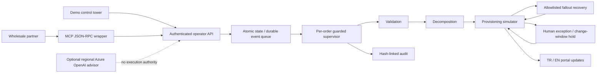

# AMA Telecom | Order-to-Activation

A working, synthetic-data demonstrator for **AMA Case Study 30: agentic B2B order-to-activation for a Turkish telecommunications operator**. It models dedicated Internet, managed SD-WAN and cloud-connect orders across an operator and a wholesale partner.

**This is not a live carrier integration, a TM Forum-certified API, or a KVKK/BTK-compliant production system.** The network, CRM, inventory and notification adapters are clearly labelled simulators. The optional regional Azure OpenAI advisor is real when configured, but has no execution authority. Without it, the application explicitly displays **Deterministic rules demo**.

## Delivery status

The source, local application, infrastructure and deployment scripts are implemented. Azure sign-in was completed during delivery, but the account exposed only a **Disabled subscription**. No Azure resource group or Azure resources could therefore be provisioned. A live Azure URL is **not** claimed. Use the local application now, and deploy after enabling a subscription or signing in with an enabled one.

## Start the demo

Requires Python 3.12+; Python 3.13 is recommended. In PowerShell:

```powershell
python -m venv .venv
.\.venv\Scripts\python.exe -m pip install -e ".[dev]"
powershell -File .\scripts\Start-Local.ps1
```

Open **http://localhost:8000**. The script generates independent manager and partner tokens into the gitignored `demo-credentials.local.json`. Click **Demo access** and paste the appropriate demo token. Do not enter an Azure password or a GitHub credential. Tokens remain in browser-tab memory, not browser storage. The local server binds only to loopback.

If your organization's PowerShell policy requires signed scripts, follow that policy; do not disable it. You can also use the Python/environment-variable launch below.

For shells other than PowerShell, install the package, set distinct random `DEMO_ADMIN_TOKEN` and `DEMO_PARTNER_TOKEN` environment variables of at least 24 characters, and run:

```text
uvicorn app.main:app --host 127.0.0.1 --port 8000 --workers 1
```

`LOCAL_STATE_PATH` defaults to `data/state.json`. Restarting the application resumes queued orders; it does not reseed or erase the existing snapshot.

## Five-minute presentation

1. Open **Control tower**: explain the five bounded agents and the synthetic-data / sovereignty banners. Four seeded orders illustrate different paths.
2. Click **New order**, select **Partner timeout**, and submit with a manager token. Open its drawer: validation, decomposition, timeout, one allowlisted recovery, provisioning and bilingual updates appear as durable transitions.
3. Create a **Route conflict** order. It stops before allocating network capacity. In **Exception desk**, approve or reject as the service manager. A partner token cannot make that decision.
4. Create a **Closed change window** order. Release it only through an explicitly audited *simulated* window approval. No production change window is bypassed.
5. Create an **Invalid site** order. The validation agent requests customer correction. Confirm the provided fictional site reference to resume.
6. Use **Wholesale partners** with the partner token: capacity checks and new orders go through the implemented MCP HTTP endpoint. Partner-submitted orders remain subject to the same supervisor policies.
7. Open **Trust & governance** to inspect provenance and the hash-linked audit. Export CSV using a manager token.
8. If regional Azure OpenAI is configured, request live advice from an order drawer. It produces schema-validated advice and TR/EN messages; it cannot approve or execute changes. Failure is explicit, never disguised as live AI success.

### What the dashboard numbers mean

The 35-day / 30% baseline, under-seven-day / under-8% ambitions, 12,000 annual orders, TRY 900 million revenue acceleration and TRY 150 million rework figures come from the assignment. They are **not achieved or measured results**. The application measures simulated completions, scenario mix, recovery count and wall-clock demo duration. Real production activation lead time, fallout reduction and NPS require a representative operational pilot; NPS is not invented.

## Architecture



Local storage uses atomic file replacement, fsync and a process lock. Azure uses private Blob contents with ETag compare-and-swap and bounded conflict retries. Order acceptance and its event are committed together. Each supervisor step consumes at most one persisted event per order, and reserves capacity at most once. Changed snapshots alone are uploaded. A single application worker / replica is intentional; this is a compact demonstration, not a high-volume distributed workflow platform.

| Assignment requirement | Implemented surface |
|---|---|
| Validation, address, feasibility, inventory | `app/domain.py`; city/site/catalogue allowlists and customer-correction pause |
| L4 decomposition, TMF622/641 | Product → service/resource orders; documented TMF-inspired REST subset |
| L3 provisioning, change windows | Guarded supervisor; explicit window and risk holds before allocation |
| L3 fallout resolution | One-attempt, allowlisted partner-timeout recovery; no arbitrary shell/tool execution |
| Customer updates in Turkish / English | Persisted bilingual customer-portal messages; no real SMS/email claim |
| Per-order event-driven supervision | Durable queued/processed events, atomic commits, idempotency keys |
| Partner integration through MCP | `/mcp`: initialization, discovery, capacity and order tools |
| Human service-manager queue | Exception desk; server-enforced manager token for decisions |
| SLA enforcement | Seven-day demo deadline; overdue work stops for an audited explicit review |
| Auditability | Hash-linked records, verification and authorized CSV; not WORM or regulatory certification |
| Data/inference localization | Synthetic-only West Europe waiver; Türkiye-hosted production design in `docs/PRODUCTION.md` |
| Realistic industry data | Public CC0 Turkish city facts plus explicitly fictional customers, prices and capacity |

## APIs and MCP

Interactive OpenAPI documentation is available at `/docs`.

| Endpoint | Purpose / authorization |
|---|---|
| `GET /api/state`, `GET /health` | Read-only synthetic workspace and supervisor health |
| `POST /api/orders` | Manager or partner creates an idempotent synthetic order |
| `POST /api/orders/{id}/decision` | Manager-only exception approve/reject |
| `POST /api/orders/{id}/address` | Manager or submitting partner confirms a fictional site |
| `POST /api/orders/{id}/advice` | Manager-only live regional AI advice; maximum 30 attempts per UTC day |
| `GET /api/audit.csv` | Manager-only audit export |
| `/tmf-api/productOrderingManagement/v4/productOrder` | TMF622-inspired GET/POST subset |
| `/tmf-api/serviceOrdering/v4/serviceOrder` | TMF641-inspired service-order GET subset |
| `/tmf-api/resourceOrderManagement/v4/resourceOrder` | Synthetic resource-order GET subset |
| `POST /mcp` | Authenticated stateless Streamable HTTP JSON-RPC partner wrapper |

The REST request is an intentionally simplified application DTO, **not the full TMF622 schema**. Filtering, pagination, hubs/callbacks, complete TMF schemas and conformance certification are not implemented. See `docs/PRODUCTION.md` before adapting a real OSS/BSS interface.

MCP supports `initialize`, `notifications/initialized`, `ping`, `tools/list` and `tools/call`. Tools are `check_partner_capacity` and `submit_partner_order`. JSON responses are used rather than SSE streams; server-side sessions are not required. No provisioning or approval tool is exposed to the partner. Both the MCP wrapper and supervisor share the same simulated capacity tool implementation.

Public synthetic views intentionally show the entire demo, including dummy partner orders. Partner-scoped authenticated TMF reads restrict orders to this demonstration's single partner. This is not a multi-tenant production portal.

## Azure deployment

All resources belong to **one brand-new resource group**. Nothing in the original GitHub repository is used.

1. Run `az login`, then `az account list --all -o table`. Select an **Enabled** subscription and confirm West Europe.
2. Ensure the subscription has `Microsoft.App`, `Microsoft.Storage`, `Microsoft.ContainerRegistry`, `Microsoft.ManagedIdentity`, `Microsoft.OperationalInsights`, and, if using AI, `Microsoft.CognitiveServices` registered. Register only with subscription-owner approval. RBAC assignments require Owner or appropriate resource deployment and role-assignment permissions.
3. For AI, first verify model availability and **regional Standard** quota in West Europe. Do not replace it with Global Standard to bypass region constraints. The defaults are `gpt-4o-mini`, version `2024-07-18`; models may retire, so verify and override with a supported regional version.
4. Deploy with Azure CLI / Bicep, no local Docker required:

```powershell
powershell -File .\scripts\Deploy.ps1 `
  -SubscriptionId "<enabled-subscription-id>" `
  -ResourceGroup "rg-ama30-demo-<unique-suffix>" `
  -Location "westeurope"
```

Add `-EnableOpenAI` only after confirming regional model availability/quota. `-BudgetEmail "<your-address>"` optionally creates RG budget alerts at 80% actual and 100% forecast. **Azure budgets use the subscription billing currency**, not necessarily US dollars; adjust the Bicep amount for the approved US$100 target before using a non-USD subscription. Alerts are not hard caps.

The script refuses an existing RG, always passes the explicit subscription, uses a unique image tag and ACR remote build, keeps deployment parameters secure, and saves credentials without printing them. It does **not** automatically delete partially created resources after a failure. Inspect the tagged dedicated group, diagnose the error, and explicitly redeploy the existing deployment or delete that exact group before a fresh run. Never reuse an unrelated group.

Deployed resources: Container Apps consumption environment and one 0.25-vCPU / 0.5-GiB replica, Basic ACR, standard LRS Blob storage, user-assigned managed identity, narrowly scoped data-plane/image-pull roles, capped Log Analytics, optional regional Azure OpenAI, optional RG budget. Storage keys and ACR admin auth are disabled; application access uses managed identity. Only the app ingress is anonymously readable, and only for synthetic demo data; writes require a demo bearer token.

The dedicated always-on replica runs the persisted supervisor when the browser is closed. Scaling to zero without adding a queue-based wake trigger would strand work, so this implementation intentionally does **not** promise scale-to-zero. Costs depend on running hours, builds, model prices and logs; the US$100/month target is not a quote or spending guarantee. Inspect current [Container Apps](https://azure.microsoft.com/pricing/details/container-apps/), [ACR](https://azure.microsoft.com/pricing/details/container-registry/), [storage](https://azure.microsoft.com/pricing/details/storage/blobs/) and [OpenAI](https://azure.microsoft.com/pricing/details/cognitive-services/openai-service/) pricing.

### Verify and clean up

```powershell
python -m pytest -q
python -m ruff check app tests scripts
node --check .\app\static\app.js
az bicep build --file .\infra\main.bicep --stdout
python .\scripts\Smoke.py --credentials .\demo-credentials.local.json
```

CI runs the Python checks, JavaScript syntax check and Bicep compilation. The smoke command creates one synthetic MCP order and verifies all five agents, bounded recovery, bilingual output and denied partner approval.

To remove the deployed demonstration, confirm the exact dedicated RG:

```powershell
powershell -File .\scripts\Remove-Demo.ps1 `
  -SubscriptionId "<subscription-id>" `
  -ResourceGroup "rg-ama30-demo-<suffix>" `
  -ConfirmResourceGroup "rg-ama30-demo-<suffix>"
```

The script checks the AMA demo tags and refuses unrelated groups. Do not run it unless you intend to delete the entire dedicated demo group and its data.

## Public reference data and licensing

City names and approximate coordinates reference Wikidata [Istanbul/Q406](https://www.wikidata.org/wiki/Q406), [Ankara/Q3640](https://www.wikidata.org/wiki/Q3640), and [Izmir/Q35997](https://www.wikidata.org/wiki/Q35997). Wikidata structured data is [CC0](https://www.wikidata.org/wiki/Wikidata:Licensing). Only these non-personal reference facts are included; no real customer dataset is downloaded. The companies, sites, inventory, prices and telecom incidents are project-authored dummy fixtures, not actual operator or subscriber records. The assignment PDF is not redistributed.
