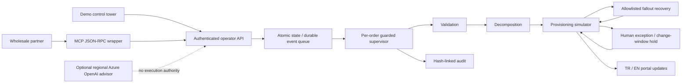

# TürkBizTel | Order-to-Activation

A working, synthetic-data demonstrator for **AMA Case Study 30: agentic B2B order-to-activation for TürkBizTel, a fictional Turkish telecommunications operator**. It models dedicated Internet, managed SD-WAN and cloud-connect orders across an operator and a wholesale partner.

**This is not a live carrier integration, a TM Forum-certified API, or a KVKK/BTK-compliant production system.** The network, CRM, inventory and notification adapters are clearly labelled simulators. The optional regional Azure OpenAI advisor is real when configured, but has no execution authority. Without it, the application explicitly displays **Deterministic rules demo**.

## Delivery status

The source, local application, infrastructure and deployment scripts are implemented. The local demo requires no Azure account. Azure deployment requires an enabled subscription, appropriate permissions, regional model quota when AI is enabled, and networking compatible with the subscription's policies. A successful resource deployment alone does not establish application readiness; verify the deployed demo before presenting it.

## Start the demo

Requires Python 3.12+; Python 3.13 is recommended. In PowerShell:

```powershell
python -m venv .venv
.\.venv\Scripts\python.exe -m pip install -e ".[dev]"
powershell -File .\scripts\Start-Local.ps1
```

Open **http://localhost:8000**. The script generates independent manager and partner tokens into the gitignored `demo-credentials.local.json`. Click **Demo access** and paste the appropriate demo token, or click **Staff sign in** (also at `/login#staff`) and paste the manager token to stay signed in for 8 hours. Do not enter an Azure password or a GitHub credential. Demo-access tokens remain in browser-tab memory, not browser storage; a signed-in session lives in that tab's own session storage, so every tab can sign in separately. The local server binds only to loopback. Customers and wholesale partners sign in on the same page (`/login`) and land on their own area (see [One landing page for everyone](#one-landing-page-for-everyone)).

If your organization's PowerShell policy requires signed scripts, follow that policy; do not disable it. You can also use the Python/environment-variable launch below.

For shells other than PowerShell, install the package, set distinct random `DEMO_ADMIN_TOKEN` and `DEMO_PARTNER_TOKEN` environment variables of at least 24 characters, and run:

```text
uvicorn app.main:app --host 127.0.0.1 --port 8000 --workers 1
```

`LOCAL_STATE_PATH` defaults to `data/state.json`. Restarting the application resumes queued orders; it does not reseed or erase the existing snapshot.

## Assignment case-study page

The public app, messages, films and fourteen-slide presentation use **TürkBizTel**.
Every film has a separate `*-turkbiztel.mp4` edition and poster; existing public
film URLs serve those editions through `app/branded_static.py`. Source MP4s remain
byte-for-byte intact, and captions, chapters and soundtracks are unchanged.
`scripts/Rebrand_Media.py` creates the derivatives with FFmpeg and refuses existing
outputs; `--edition` appends a new film without replacing earlier branded media.
The latest solution is 2:56 with the current-state film's narrator.
Legacy cookie, session-storage and signing identifiers stay stable to preserve
existing sign-ins; they are compatibility identifiers, not public branding.

**`/case-study`** (also `/assignment`) is the page to present the assignment from. It is public in demo and live mode, needs no sign-in, and takes a reviewer through four chapters at their own pace. Open it first: **http://localhost:8000/case-study**.

| Chapter | What it shows |
|---|---|
| Intro | The case study, the story in one sentence, the headline numbers and the four stops |
| 1 Today | The latest current-state film, `current-scenario.mp4` (1 min 51 s), with chapters, captions and a transcript |
| 2 Architecture | The 14-slide architecture deck, including the cost of implementation (slide 13), as an interactive viewer (arrow keys, swipe, filmstrip, full screen), with the PowerPoint and a PDF to download |
| 3 Solution | The customer solution film, `solution-tower-v6.mp4` (2 min 56 s), using the current-state film's British-English male narrator, introducing each AI agent once and using shorter agent names afterward, with chapters, captions and a transcript |
| 4 Live app | The 2:21 app-highlights film (`app-walkthrough.mp4`) bridges the solution story to the interactive app below. It covers customers, partners, the service team, five agents, Analytics and governance, with six chapter jumps and a transcript. George narrates without acceleration; long pages scroll to the bottom and captions stay below the app. The recording uses isolated synthetic accounts and simulated provisioning/payments. The app below is live: sign in, place or track an order, or enter the service-team console |

Move with **Start the journey**, the chapter rail or the *Next* and *Back* buttons, with ← → (slides inside the deck, chapters elsewhere), **1**–**4** to jump to a chapter and **F** for full screen on the deck. Every chapter and slide has a link you can share: `/case-study#/today`, `#/architecture/7`, `#/solution`, `#/app`.

- **Self-contained.** Films, captions, slide images and downloads are all served by the app from `app/static/` and `app/static/case-study/`; there are no third-party scripts, fonts or images, and the page follows the same strict content-security policy as the rest of the site (no inline script or style). Films load only when their chapter is opened and never start by themselves.
- **Framing.** The live-app chapter shows the app in a frame, so the site sends `X-Frame-Options: SAMEORIGIN` and `frame-ancestors 'self'` on every page: only this origin may frame it.
- **Service-team entry.** Select **Service team sign-in** above the embedded app, or open `/login#staff` directly. The token option also appears above the email fields on the normal sign-in form. The frame's **Open in a new tab** link preserves that panel; each tab still signs in separately. On a single sign-on deployment the page asks the app which sign-in it uses and describes the entry that is really there: **Sign in with your Microsoft work account**.
- **No credentials.** The page never shows a token or a password. Partner and service-team sign-in details are shared with the submission, not published on the page.
- **Honest labels.** The 35 days and 30% fallout are the assignment's baselines. The under-7-days and under-8% goals and the TRY 900 million and TRY 150 million figures are targets to prove in a pilot, not results. Hosting in-country on Azure Local is proposed, not deployed. The cost slide is a planning estimate built on stated assumptions (Azure list prices for the demo, assumed team size and rates for the programme), not a quote. The operator is fictional and the TM Forum-style APIs are simplified, not certified.
- **The deck on the web is an edition of the original.** The branded web edition has 14 slides, including the cost-of-implementation slide, plus a PDF. The author's working deck is kept outside this repository. It ended with a hand-off slide (the 15th) that held local file paths, demo sign-in details and the live admin token. Never publish or commit that slide; if a deck was ever shared with it, rotate `DEMO_ADMIN_TOKEN` and the demo accounts' passwords. The deployed demonstrator's admin token and demo sign-ins were last rotated on 20 November 2026. The shipped PowerPoint carries the author's name in its document properties and a Microsoft sensitivity-label part (`docMetadata/LabelInfo.xml`) from the tenant it was authored in, so confirm the deck may be shared before you distribute it. To change a slide, export it again as `slide-NN.webp` and `thumb-NN.webp` in `app/static/case-study/` and update its caption in `case-study.html`.

`tests/test_case_study.py` covers the routes, framing headers, content-security policy, absence of credentials and local paths, service-team entry, the files the page uses, film and caption endpoints, and chapter timings against the latest narration.

## Live agent and exception walkthrough

Open **`/static/live-demo.html`** on a running local or deployed application,
or select **Live agent walkthrough** in the control tower. Unlike the films,
this page displays actual persisted API events, linked work and TR/EN portal
messages. The specialists remain deterministic, bounded simulator components;
this is not a claim of autonomous LLM agents or real carrier provisioning.

Load the deployment's local credentials JSON using the file picker, or enter its
two demo tokens. Never enter an Azure password/token. Credentials must match the
page's origin and remain in tab memory; nothing is stored in browser storage.
Launch straight-through activation, timeout recovery, route conflict, a closed
change window or an invalid site through the TMF-inspired API or MCP.
Inspect the saved event, responsible specialist, hold and output.
Queued stages are labelled **queued**, not falsely presented as active execution.

Human routes wait until an authorized operator explicitly approves, rejects or
confirms a customer-provided fictional site. The partner-denial check authenticates
the partner and verifies its restricted read role before attempting the denied
approval; accidentally entering a manager token cannot turn that check into an approval.
Evidence downloads contain the observed order/events/audit, never access tokens.

For repeatable verification against the running application:

```powershell
python .\scripts\Verify_Demo.py `
  --credentials "C:\private\demo-credentials.local.json" `
  --report "C:\private\agent-demo-evidence.json" `
  --allow-manager-decisions
```

This creates **six new synthetic orders**, normally reserves five simulated
capacity units, and explicitly records automated *test* approvals, rejection and
site correction. It verifies all five specialists, one retry, handback order,
holds before allocation, partner HTTP 403, idempotency, invalid catalogue input,
linked completion, bilingual messages and audit integrity. Existing evidence
files are protected. These are automated demo decisions, not a human acceptance
test. The verifier does not call billable AI or alter infrastructure.

Azure deployment still requires a user-confirmed subscription, region and
resource/cost scope. The public-cloud demo cannot satisfy the proposed
Türkiye-resident production architecture: Azure Local requires an approved
existing target or supported hardware and deployment prerequisites.

## Five-minute presentation

For the **latest customer solution with first-mention AI-agent introductions**, open
**http://localhost:8000/static/solution-tower-v6.html**. The narrator explicitly says
Orchestration AI Agent, Validation AI Agent, Decomposition AI Agent,
Provisioning AI Agent, Fallout Recovery AI Agent and Customer Updates AI Agent
on each role's first mention, then uses the shorter names such as
Fallout Recovery Agent and Provisioning Agent. The visual labels and responsibilities are
unchanged; captions and transcripts follow the revised speech.
The same British-English male `bm_george` voice is retained in a 2:56 film.
Its source is `scripts/film3d/tower-first-mention-story.json`; synthesize with
`Synthesize_Preset.py --voice bm_george --speed 1.08`, render with `Render_Crisp.py`
and that `--story`, then brand the new edition with `Rebrand_Media.py --edition`.
The script selects pitch-preserving 1.20x delivery to keep the fuller names
within three minutes. The standalone player and case-study embed use the same film.
The previous full-name-on-every-reference edition, `solution-tower-v5.html`,
and its `tower-ai-agent-story.json` source remain unchanged.

For the **previous customer solution edition matching the current-state film's voice**, open
**http://localhost:8000/static/solution-tower-v4.html**. It uses the same
British-English male Kokoro `bm_george` preset, pinned models and 1.08x synthesis
speed as `current-scenario.mp4`, in a full-HD film running about 2:55.
The customer story, tower, agents and exception
routes are unchanged from v3. Pitch-preserving 1.15x delivery, presence EQ and
gentle compression retain the solution film's brisk presentation.
Every earlier video, including v3 and the current-state film, remains unchanged.
To reproduce, synthesize `tower-customer-story.json` with
`Synthesize_Preset.py --voice bm_george --speed 1.08` into a fresh private directory,
then render it with `Render_Crisp.py --story .\scripts\film3d\tower-customer-story.json`,
the matching `--narration-dir` and an unused `--edition`.

For the **previous customer solution edition**, open
**http://localhost:8000/static/solution-tower-v3.html**. This separate full-HD
film uses positive customer-facing copy instead of draft-status overlays,
with newly generated energetic narration. It describes business objectives
without presenting assignment percentages as achieved customer results.
Azure Local is explained as the residency architecture with concrete local
infrastructure, service and egress requirements. The player retains delivery
scope details separately from the main presentation.
Every earlier MP4, including `solution-tower-v2.mp4`, is preserved byte for byte
against the workspace snapshot taken at the start of this render.

The customer script is `scripts/film3d/tower-customer-story.json`.
Use `Synthesize_Preset.py` with that script and a fresh private narration directory,
then `Render_Crisp.py --story .\scripts\film3d\tower-customer-story.json`
with a new `--edition` and the matching `--narration-dir`.
The renderer checks every drawn narration beat for draft-status wording,
caption fit and animation before producing the new media.

For the **crisp control-tower edition with a new narrator**, open
**http://localhost:8000/static/solution-tower-v2.html**. It uses the selected
original tower design and five specialist avatars, with shorter message cards,
clearer causal benefits and a **different, locally generated neural preset voice**.
The full-HD film runs **153.5 seconds (about 2:34)** and includes 12 chapters.
The narrator is Kokoro `af_heart`, American English, at 1.08x synthesis speed with pitch-preserving
1.15x delivery treatment, presence EQ and gentle compression. This is not the author's
cloned voice. It retains human approvals, bounded timeout recovery, standards
caveats, official Microsoft product icons and the proposed Azure Local boundary.
All earlier films, including the original tower edition, remain unchanged.

The revised script is `scripts/film3d/tower-crisp-story.json`. To reproduce locally,
install `scripts/requirements-narrator.txt` into an isolated optional environment;
the app runtime does not need these packages. Download the pinned public
`kokoro-v1.0.onnx` and `voices-v1.0.bin` assets from
[kokoro-onnx's model-files-v1.1 release](https://github.com/thewh1teagle/kokoro-onnx/releases/tag/model-files-v1.1).
The synthesizer verifies their SHA-256 values before use. Model weights are
[Apache-2.0](https://huggingface.co/hexgrad/Kokoro-82M); the kokoro-onnx runtime is MIT.
Weights and intermediate WAVs remain outside the repository. No reference sample
is used and no script is sent to an external speech service.

```powershell
python .\scripts\Synthesize_Preset.py --story .\scripts\film3d\tower-crisp-story.json --models "C:\private\narrator-models" --output "C:\private\new-narration"
python .\scripts\Render_Crisp.py --edition solution-tower-v3 --narration-dir "C:\private\new-narration"
```

Use the isolated narrator Python for synthesis and the app environment for rendering
(Microsoft Edge, Playwright and FFmpeg are required). `--preview-only --review-dir`
on the renderer checks all 24 beats before encoding. The final film includes 12
chapters, synchronized captions and an original restrained soundscape; the renderer
verifies full decode, visible animation and every earlier MP4's hash. Existing
output names and existing intermediate narration are refused, not overwritten.

For the **clear ownership edition**, open
**http://localhost:8000/static/solution-clarity-v2.html** or select **Clear ownership**
in the control-tower banner. A single focal 3D scene sits beside readable
responsibility, output, exception, human-owner and impact panels. The normal
validation/planning/provisioning/update route is separate from timeout-only
recovery, which returns to provisioning. A suited customer and human service manager
retain the licensed Rocketbox models; Microsoft product icons remain unchanged.
The locally generated author voice uses revised narration, pitch-preserving energy
and deliberate reading holds. All older films and players remain available.

Early validation, linked identifiers, allocate-once guards, persisted handoffs and
bounded recovery explain the expected reduction in avoidable rework and queue dwell.
**35 days to under 7 and 30% fallout to under 8% are assignment targets, not measured
results**. A representative pilot must measure lead time, first-time-right completion
and recovery/human-review waiting. New catalogue onboarding, generic failure triage
and external delivery incidents are explicitly **proposed production gates**,
not demo queues. The Azure Local residency design also remains proposed.

Rebuild into a **new** edition with existing private revised voice segments outside
the repository (do not upload the reference sample or generated private segments):

```powershell
npm.cmd --prefix .\scripts\film3d run build:clarity
python .\scripts\Render_Clarity.py --edition solution-clarity-v3 --narration-dir "C:\private\clarity-narration"
```

The segment manifest must match `scripts/film3d/clarity-story.json` exactly.
`--preview-only --review-dir "C:\private\clarity-review"` checks every responsibility
and exception beat without encoding a film. The final render enforces full HD,
under three minutes, voice, twenty captions, ten chapters, real scene motion,
non-overlapping regions, readable type and preservation of every existing MP4.
Existing edition names are refused before any player or metadata changes.

For the **true 3D edition**, open
**http://localhost:8000/static/solution-3d-v1.html** or select **3D edition** in
the control-tower banner. The complete journey uses lit WebGL meshes, perspective
cameras, shadows, a suited human customer and a distinct human service manager
from Microsoft's MIT-licensed Rocketbox library. Human close-ups transition to
the giant orchestration tower and five different 3D agents. Official Azure Local,
Azure Arc, Azure Container Registry and Azure Monitor icons are used unchanged,
upright and labelled. These are rendered humans, not live-action actors.
Asset sources and licenses are retained in `app/static/film3d-assets/ATTRIBUTION.md`.

The full-HD, under-three-minute film reuses the energetic tower edition's audio
without changing its tempo or re-encoding its final audio track. Earlier MP4s stay
byte-for-byte unchanged. The player retains captions, chapters, a transcript and
a silent interactive 3D preview. Playing the finished video needs no WebGL;
the optional interactive preview does. Existing workflow, conformance caveats,
business-target caveats and **proposed, not deployed** residency boundaries remain.

To rebuild the optional renderer with Node.js, Microsoft Edge, Playwright and
FFmpeg available, use a **new** edition name:

```powershell
npm.cmd --prefix .\scripts\film3d ci --no-audit --no-fund
npm.cmd --prefix .\scripts\film3d run build
python .\scripts\Render_3D.py --edition solution-3d-v2
```

On other platforms use `npm` instead of Windows' `npm.cmd`. `--prepare-only`
prepares a new player; `--preview-only --review-dir "C:\private\3d-review"`
verifies the true 3D geometry, rigged humans, cameras and official icons without
rendering the MP4. An existing output film is refused before its assets change.
The renderer verifies encoded motion, all chapters, full decode and previous
video hashes before exclusively creating the new MP4. Public dependencies and
licensed assets are downloaded separately; narration and rendering stay local.

For the **new control-tower edition**, open
**http://localhost:8000/static/solution-tower-v1.html**. A large orchestration tower
overlooks five distinct animated specialists: a validation inspector with a magnifying
glass, decomposition architect with a hard hat, provisioning cable technician,
fallout rescue mechanic and headset-wearing customer messenger. The tower personifies
the actual deterministic, policy-guarded supervisor, not an unrestricted AI controller.
Event handoffs, expressive characters and completion particles make the full-HD journey
more playful without changing the implemented workflow or proposed residency boundaries.

This edition keeps the author's synthetic voice, with pitch-preserving 10% brisker
pacing, presence EQ, gentle compression and an original quiet pulse/transition soundscape.
The captions and chapters follow the new audio timing; the film stays below three minutes.
**Earlier videos are not replaced.** Regenerate to a new version with
`python .\scripts\Render_Orchestration.py --edition solution-tower-classic-v2`.
The renderer refuses an existing output video, reads the previous solution film's audio
without accessing the private voice sample, and verifies that every existing static MP4
still has its original SHA-256. Its edition-specific evidence and motion files record
the preservation check and motion measured in the encoded video.

For the **new solution end to end**, open
**http://localhost:8000/static/solution.html** or select **Solution film** in the
control-tower banner. The under-three-minute HD MP4 is a character-led motion-graphics
film with locally synthesized author-voice narration: a customer submits an order, moving packets propagate persisted events,
and an activation rail shows the agents waiting, queued, active, held and done
at different stages. Order A follows timeout recovery, B illustrates human
review and C enters through partner MCP. Industry-standard labels appear at
the product/service/resource handoffs, with full conformance clearly a future gate.
The final chapters animate a **proposed, not deployed Azure Local architecture**
in Türkiye: local customer data and inference, conditionally approved external
Azure services, blocked customer-data egress, and a disconnected alternative
when even platform metadata cannot leave. See `docs/PRODUCTION.md` for the
boundary assumptions and official sources. The film connects each mechanism
to business objectives and explains how a representative pilot would prove impact.
It includes burned-in English captions, a downloadable WebVTT track, embedded MP4
chapters, chapter navigation, a full transcript and downloadable video.

Türk Telekom's public-domain geometric logo is included only as Turkish industry
context, with source and trademark attribution in the player. No affiliation,
endorsement, customer relationship or live integration is claimed; AMA remains
fictional. Business targets are explicitly not achieved results.

Regenerate this separate film with the same optional local presentation tools
described below: `python .\scripts\Render_Solution.py` (optionally `--fps 12`
or `--voice "Microsoft David Desktop"`). It starts and stops its own temporary
loopback instance with fresh random credentials, captures and verifies the five
order scenarios plus partner submission, and leaves saved demo state untouched.
`solution-evidence.json` records synthetic workflow outcomes without credentials.
The film uses original animated characters, glowing event trails, staggered diagram
reveals, agent avatars and completion particles, not a slideshow of these captures.
Motion timing is illustrative and narration-aligned, not an elapsed-time
benchmark. The player also includes a playable, scrubbable silent animation.
Rendering and narration are local; no repository content is uploaded.

For personalized narration, use a separate Python environment with optional
`qwen-tts`, matching CUDA-enabled `torch` / `torchaudio`, `faster-whisper` and FFmpeg.
The [Qwen3-TTS Base model](https://huggingface.co/Qwen/Qwen3-TTS-12Hz-0.6B-Base)
is Apache-2.0. Use only a voice sample you have permission to reproduce:

```powershell
python .\scripts\Synthesize_Solution.py `
  --reference "C:\private\Telecom_voice.m4a" `
  --output-dir "C:\private\telecom-narration" `
  --model-cache "C:\private\speech-models"
python .\scripts\Render_Solution.py --narration-dir "C:\private\telecom-narration"
```

Public model downloads precede local-only reference transcription and synthesis.
Use `--limit 2` for a private audition before the full synthesis. Keep the reference,
transcript, intermediate speech and model files outside the repository; the script
refuses output/cache directories inside it. Only the finished film is published.
The player discloses synthetic author-voice narration; it is not an original recording
of the entire script. Narration manifests must match every script beat, and rendering
rejects narration over 179 seconds or an encoded MP4 over 180 seconds without truncation.
Regeneration without `--narration-dir` explicitly uses a system voice instead.

For the **current-state story from the assignment PDF**, open
**http://localhost:8000/static/journey.html** or select **Animated walkthrough**
in the control-tower banner. *The waiting order* is an **under-two-minute, 720p
narrated MP4** with animated people, an Istanbul-inspired skyline, moving order
packets, a reference-mismatch example, a fallout loop, a five-week calendar and
an original quiet pulse soundtrack. It includes burned-in English captions,
chapter navigation, MP4 / WebVTT downloads and a full transcript.
It covers only the existing manual process and its challenges, not the implemented
software or proposed transformation.
The business-audience edition uses plain wording in narration, captions and
on-screen labels: direct order sharing, customer records, working service and
orders needing more work replace technical abbreviations and operations jargon.
The 35-day / 30% case-study facts and British male delivery are retained.

The original explanatory story is adapted from page 1 of
`AMA_Assignment30_HaiderRaza.pdf`: CRM, order management, inventory, field services,
partner systems, manual re-keying, missing wholesale API access, fallout and
customer/business impact. The PDF's 35-day and 30% figures are stated case-study
baselines, not measured repository results. The individual order, copied-reference
mismatch, queues and customer dialogue are explicitly illustrative; stage-level
wait durations are not invented. Turkcell, Türk Telekom and Vodafone Türkiye marks
introduce the real Turkish market; the fictional case's challenges are **not**
attributed to those providers. The player links to their official websites and
the official sources of the included logos. No affiliation or endorsement is implied.
The source PDF is not redistributed. The expandable animated storyboard uses
the same canvas renderer as the exported video and provides a silent, step-through version.

To regenerate the film on Windows, install the optional presentation tools
`playwright`, `pywin32`, Microsoft Edge and FFmpeg (on PATH), start the app, and run
`python .\scripts\Render_Story.py`. Without private voice segments, the script uses
the locally installed Microsoft Zira speech voice; `--voice` can select another
installed Windows voice. The player explicitly discloses the narration method.
`--url` selects a non-default local demo address. It regenerates the MP4, poster,
WebVTT captions and audio-aligned storyboard timing without sending content to
an external speech or rendering service. These tools are not needed to play the film.
The renderer rejects narration over 119 seconds and checks that the encoded
MP4 is strictly under 120 seconds, has audio and is 1280x720; it never truncates the story.

To use the author-provided sample with the optional local speech tools above,
generate **separate current-state segments** (do not reuse solution-film narration):

```powershell
python .\scripts\Synthesize_Solution.py `
  --story ".\app\static\journey-data.json" `
  --reference "C:\private\Telecom_voice.m4a" `
  --output-dir "C:\private\current-state-narration" `
  --model-cache "C:\private\speech-models"
python .\scripts\Render_Story.py --narration-dir "C:\private\current-state-narration"
```

The latest current-state film instead uses a **British-English male neural
narrator** (`Kokoro / bm_george`), with brisk 1.08x synthesis, presence EQ and gentle
compression. It does not imitate the author's voice. To reproduce it with the
optional preset narrator tools and pinned Kokoro models described above:

```powershell
python .\scripts\Synthesize_Preset.py --story .\app\static\journey-data.json `
  --models "C:\private\narrator-models" --output "C:\private\current-state-british-male" `
  --voice bm_george --speed 1.08
python .\scripts\Render_Story.py --narration-dir "C:\private\current-state-british-male"
```

British presets use `en-gb` pronunciation; American presets retain `en-us`.
The current-state business story, animation and under-two-minute limit are preserved;
captions and scene timings are regenerated to match the new delivery.

Speech synthesis and reference transcription run locally. The manifest must match
every current script beat. Keep reference audio, transcripts, model caches and
intermediate narration outside the repository. The player labels cloned speech
as synthetic author-voice narration, not an original full-script recording.
`--offline-models` uses already downloaded `qwen\` and `whisper\` folders under
`--model-cache` without network model access. A compatible optional speech stack
uses `qwen-tts==0.1.1`, `gradio==5.49.1`, `librosa==0.11.0` and matching
CUDA-enabled `torch==2.8.0` / `torchaudio==2.8.0`; keep it in a separate environment.

1. Open **Control tower**: explain the five bounded agents and the synthetic-data / sovereignty banners. Four seeded orders illustrate different paths.
2. Click **New order**, select **Partner timeout**, and submit with a manager token. Open its drawer: validation, decomposition, timeout, one allowlisted recovery, provisioning and bilingual updates appear as durable transitions.
3. Create a **Route conflict** order. It stops before allocating network capacity. In **Exception desk**, approve or reject as the service manager. A partner token cannot make that decision.
4. Create a **Closed change window** order. Release it only through an explicitly audited *simulated* window approval. No production change window is bypassed.
5. Create an **Invalid site** order. The validation agent requests customer correction. Confirm the provided fictional site reference to resume.
6. Use **Wholesale partners** with the partner token: capacity checks and new orders go through the implemented MCP HTTP endpoint. Partner-submitted orders remain subject to the same supervisor policies.
7. In **Wholesale partners**, click **Add partner** (demo partners are named “Demo …”), copy the one-time invitation link and open it in a private window to set a password. As the partner, check each delivery's expected date, confirm an address that needs attention and raise a concern. As staff, answer it from the **Concerns** inbox, then record the payment under **Manage** and watch it appear on the partner's **Payments** page (see [Partner portal](#partner-portal)).
8. Open **Trust & governance** to inspect provenance and the hash-linked audit. Export CSV using a manager token.
9. If regional Azure OpenAI is configured, request live advice from an order drawer. It produces schema-validated advice and TR/EN messages; it cannot approve or execute changes. Failure is explicit, never disguised as live AI success.

On a single sign-on deployment, **New order** in steps 2 to 5 asks you to pick an enterprise instead. Its contact approves the order, from the e-mail or from their own account, before any agent starts (see [Orders placed for an enterprise](#orders-placed-for-an-enterprise)).

### What the dashboard numbers mean

The 35-day / 30% baseline, under-seven-day / under-8% targets, 12,000 annual orders, TRY 900 million revenue acceleration and TRY 150 million rework figures come from the assignment. They are **not achieved or measured production results**. The control tower shows simulated completions, scenario mix, recovery count and wall-clock demo duration. The **Analytics** tab measures order-to-delivery time, fallout and each agent's time on this application's own orders against the 7-day and 8% targets (see [Analytics and the Azure SQL database](#analytics-and-the-azure-sql-database)); those are simulator orchestration times, so they show that the pipeline and the measurement work, not that real activation will take 7 days. Real production activation lead time, fallout reduction and NPS require a representative operational pilot; NPS is not invented.

## Architecture



Local storage uses atomic file replacement, fsync and a process lock. Azure uses private Blob contents with ETag compare-and-swap and bounded conflict retries or, when Azure SQL is enabled, one SQL row read and written under a lock, with relational tables refreshed in the same transaction for reporting. Order acceptance and its event are committed together. Each supervisor step consumes at most one persisted event per order, and reserves capacity at most once. Changed snapshots alone are uploaded. A single application worker / replica is intentional; this is a compact demonstration, not a high-volume distributed workflow platform.

| Assignment requirement | Implemented surface |
|---|---|
| Validation, address, feasibility, inventory | `app/domain.py`; city/site/catalogue allowlists and customer-correction pause |
| L4 decomposition, TMF622/641 | Product → service/resource orders; documented TMF-inspired REST subset |
| L3 provisioning, change windows | Guarded supervisor; explicit window and risk holds before allocation |
| L3 fallout resolution | One-attempt, allowlisted partner-timeout recovery; no arbitrary shell/tool execution |
| Customer updates in Turkish / English | Persisted bilingual customer-portal messages; no real SMS/email claim |
| Per-order event-driven supervision | Durable queued/processed events, atomic commits, idempotency keys |
| Partner integration through MCP | `/mcp`: initialization, discovery, capacity and order tools |
| Human service-manager queue | Exception desk; server-enforced manager token for decisions, or the service-manager role on a single sign-on deployment |
| SLA enforcement | Seven-day demo deadline; overdue work stops for an audited explicit review |
| Auditability | Hash-linked records, verification and authorized CSV; not WORM or regulatory certification |
| Data/inference localization | Synthetic-only West Europe waiver; Türkiye-hosted production design in `docs/PRODUCTION.md` |
| Realistic industry data | Public CC0 Turkish city facts plus explicitly fictional customers, prices and capacity |

## Customer portal and live mode

Customers can order themselves at `/order` (no token needed) and follow or change the order at `/track` using the private link shown after ordering (also included in e-mail/SMS updates). The portal captures company, city, service, installation address, contact person, e-mail/mobile, preferred channel and update frequency, plus consent. Customers can only see their own order through an unguessable per-order tracking token (HMAC of the order id, key `AMA_TRACKING_SECRET`, falling back to the admin token) and never see audit, agent or partner data. An address that does not mention the selected city holds the order and triggers the automatic reminders.

Settings (container app environment variables):

| Variable | Purpose |
| --- | --- |
| `AMA_MODE=live` | Accept real company names, seed no demo orders, require staff authentication (a staff session or, unless `AMA_STAFF_AUTH=sso`, the admin token) for `/api/state`, show anonymous visitors the sign-in page instead of the console, use customer-neutral wording. Default `demo`. |
| `AMA_MAX_ORDERS` | Order cap (default 200). |
| `AMA_MAX_CUSTOMERS` | Customer account cap (default 1000). |
| `AMA_MAX_ORDERS_PER_CUSTOMER` | Orders one customer account may place (default 25). |
| `AMA_MAX_PARTNERS` | Partner organisations that can be created (default 50). |
| `AMA_SESSION_SECRET` | Signing key for sign-in sessions (tab tokens and cookies). Falls back to `AMA_TRACKING_SECRET`, then to the admin token. Set a dedicated random value (32+ characters recommended) so rotating the admin token does not also sign every customer out. Required, at 32+ characters, when `AMA_STAFF_AUTH=sso`. |
| `AMA_DELIVERY=live` | Really send updates. **Required in live mode for sign-up verification and password-reset codes**; without it, live mode cannot deliver them and says so rather than showing a code on screen. E-mail needs either `ACS_CONNECTION_STRING` + `ACS_EMAIL_SENDER` (Azure Communication Services Email) or, as an alternative, `SMTP_HOST`, `SMTP_FROM` (optional `SMTP_PORT`, `SMTP_USER`, `SMTP_PASSWORD`, `SMTP_STARTTLS`) for e-mail and `AMA_SMS_WEBHOOK_URL` (https, optional `AMA_SMS_WEBHOOK_TOKEN`) for SMS; the app refuses to start if incomplete. Failed sends retry 3 times, then show as `failed`. |
| `AMA_PUBLIC_ORIGIN` | HTTPS origin used to build tracking links in messages. With `AMA_STAFF_AUTH=sso` it is also the address Microsoft returns the browser to after sign-in, so it is required and must match the redirect address registered for the application. |
| `AMA_STAFF_AUTH` | `token` (default): the service team signs in with the manager token. `sso`: Microsoft Entra single sign-on replaces the token, and the app refuses to start unless its single sign-on settings are complete (the tenant and application IDs, a session secret, the public origin and the managed identity). See `docs/STAFF-SSO.md`. |
| `AMA_SSO_TENANT_ID`, `AMA_SSO_CLIENT_ID` | The Microsoft Entra tenant and the application registration the service team signs in through (both GUIDs). `scripts/Register-StaffSso.ps1` creates the registration and `Deploy.ps1 -StaffAuth sso` sets both. |
| `AZURE_CLIENT_ID` | In `sso` mode, the app's managed identity. The application registration trusts it through a federated credential, so there is no client secret to store. `AMA_SSO_CLIENT_SECRET` replaces it for local development only. |
| `AMA_STAFF_SESSION_HOURS` | How long a service-team session lasts in `sso` mode, between 0.25 and 12 (default 4). |
| `DEMO_REMINDER_SECONDS` | Stuck-order reminder interval (default 300). |
| `AMA_SQL_SERVER`, `AMA_SQL_DATABASE` | Store all data in Azure SQL Database instead of Blob or the local file. Set both or neither (one alone stops the app at start-up). The app signs in with its managed identity (`AZURE_CLIENT_ID`); there is no SQL password. |
| `AMA_SQL_AUTO_SCHEMA` | Default `true`: the app creates or upgrades its own tables. The Azure deployment sets `false` because the app's identity may not change the schema; prepare the database once with `python -m app.sqlbootstrap` instead. |

Not yet production-grade: fulfilment (partner capacity and network activation) is still the in-process simulator, so a processed order does not provision a real service until real OSS/BSS adapters replace it; state, including customer accounts, lives in a single order-state document (a JSON/Blob snapshot, or one JSON row in Azure SQL with derived reporting tables) rather than a normalised transactional database; customers and partner contacts sign in with a password and e-mailed codes (no SSO or multi-factor), partner invoices are simulated pro-forma documents rather than ERP records, and, unless you deploy the single sign-on build, back-office staff share one manager token instead of having named users. See `docs/PRODUCTION.md`.

## One landing page for everyone

There is a single sign-in page. It is the home page (`/`) in live mode and is always available at `/login`. Customers, wholesale partners and the service team all start there and are sent to the page made for them:

| Who | Signs in with | Lands on |
|---|---|---|
| Customer | E-mail and password (**Create an account** for a new customer) | `/account` |
| Wholesale partner | E-mail and password, after accepting an invitation from the service team | `/partner` |
| Service team | The manager token (**Sign in with your access token**, or `/login#staff`). On a single sign-on deployment, their own Microsoft work account (**Sign in with Microsoft**) | `/console` |

The page script does the routing: the sign-in page moves a signed-in visitor on to their own area, and `/console`, `/partner` and `/account` each check who is signed in and move a visitor of another role to theirs (or to the sign-in page when nobody is signed in). A partner who opens `/console` or `/account` therefore lands on `/partner`, and a customer lands on `/account`. The role-specific APIs also refuse a session that belongs to another role. In demo mode an anonymous visitor of `/` still sees the public read-only console, and **Demo access** with a demo token keeps working.

**Each tab signs in on its own.** Every browser tab or window keeps its own sign-in, so one browser can hold a customer, a partner and a staff member side by side, and a new tab at `/` always shows the sign-in form. The signed session token lives in that tab's `sessionStorage` and is sent as `X-Session` together with `X-Session-Mode: tab`; nothing is shared through cookies or `localStorage`. Refreshing a tab or moving around the site keeps it signed in, closing the tab ends its sign-in, and signing out affects only that tab. (Browsers copy a tab's session storage to a tab opened from it with a link or **Duplicate**; the copy is independent afterwards.) Scripts and API clients that do not send `X-Session-Mode: tab` keep using the `myturkei_session` cookie.

## Customer accounts and staff sign-in

Customers who want one place for all their orders sign in at **`/login`** (create an account, sign in, or reset a forgotten password) and use **`/account`**: *My orders* (progress, status and next step for each order), *New order*, per-order detail with a progress tracker and update history, a guided fix when information is missing or incorrect (site address, contact person, e-mail/phone, channel and update frequency) and *Profile* (name, company, phone, language and password). The pages are mobile-friendly, and order updates are shown in the language the customer chose (English or Türkçe). Guest ordering at `/order` and `/track` still works without an account. An order that a service engineer placed for the customer's company (single sign-on build) shows as *Needs your approval*, with **Approve this order** and **Decline this order** in its detail, and nothing starts until the customer approves; see [Orders placed for an enterprise](#orders-placed-for-an-enterprise).

| Visitor | What they can reach |
|---|---|
| Not signed in | `/order`, `/track` with a private link, `/login`. In demo mode also the public read-only console; in live mode `/` shows the sign-in page, `/partner`, `/account` and `/console` lead to it, and `/api/state` returns 401. |
| Customer | Only `/account` and their own orders (`/api/me/*`); another customer's order answers 404. Opening `/`, `/console` or `/partner` moves them on to `/account`. Staff-only APIs (`/api/orders`, decisions, `/api/audit.csv`, TMF, MCP and, in live mode, `/api/state`) return 403 for a customer session. |
| Partner | Only `/partner` and its own organisation's deliveries, invoices and concerns (`/api/partner/*`); another partner's order answers 404. Opening `/`, `/console` or `/account` moves them on to `/partner`. Staff-only APIs return 403 for a partner session. |
| Staff | The whole console: Control tower, Order workspace, Exception desk, Wholesale partners (which also administers partner accounts, invoices and concerns), Trust & governance, Analytics and the five agent tabs. On a single sign-on deployment the person's role sets how much of it they can change. |

**Staff sign-in.** Click **Sign in with your access token** on the landing page (or open `/login#staff`, or click **Staff sign in** in the demo console) and paste the manager token (`DEMO_ADMIN_TOKEN`). That tab then holds an 8-hour session (a signed token in the tab's session storage) and opens the console, so the manager token is not pasted again and is never stored. Other tabs are not signed in by it. **Demo access** and `Authorization: Bearer` still work for API clients and the partner token. Changing `DEMO_ADMIN_TOKEN` ends every staff session. This is one shared credential, not per-user accounts; the single sign-on build described next replaces it with named people.

**Staff sign-in with single sign-on.** A deployment started with `AMA_STAFF_AUTH=sso` (`Deploy.ps1 -StaffAuth sso`) has no staff token at all. **Sign in with Microsoft** sends the person to Microsoft Entra ID to sign in with their own work account, under whatever multi-factor and conditional-access policy the tenant sets. The app accepts the sign-in only for its own tenant and application, and only from a person who holds one of three app roles: `ServiceAuditor` (read), `ServiceOperator` (also place orders for an enterprise, correct orders, ask for advice, handle concerns) or `ServiceManager` (also decide exceptions and manage partners). The highest role wins, and a person with none is turned away with a plain message. Customers and partners sign in exactly as before. Every staff change is recorded with the person's name, user principal name and role and, for edits, the fields they changed: the Trust & governance tab filters by person, and `GET /api/audit` and the CSV export carry the same columns. A bearer manager token opens no staff call, and `POST /api/auth/staff` answers 403. Staff sessions last 4 hours by default (`AMA_STAFF_SESSION_HOURS`, 12 at most). They are stateless, so a person removed in Entra keeps access until theirs ends, and replacing the session secret ends every session at once. [STAFF-SSO.md](STAFF-SSO.md) has the setup, the role table and the audit queries.

**Sign-up and verification.** An account works immediately after sign-up. The customer confirms their e-mail with a 6-digit code (valid 15 minutes, 5 attempts, one resend per minute). Confirming it attaches any guest orders placed at `/order` with the same e-mail, so nobody can claim another company's orders without access to the mailbox. A forgotten password is reset with the same kind of code; in live mode the reply is identical whether or not the address has an account.

| Configuration | How a code reaches the customer |
|---|---|
| `AMA_DELIVERY=live` | Sent by e-mail through the configured provider. |
| Demo mode, delivery not configured | Shown on screen so the demo works end to end. |
| `AMA_MODE=live`, delivery not configured | Not delivered and never shown; the page says the e-mail could not be sent and to try again later. Always set `AMA_DELIVERY=live` in live mode. |

**Security model.** Passwords are stored as salted scrypt hashes; weak, common or e-mail-derived passwords are refused. Sign-in sessions are HMAC-signed and last 8 hours (4 for the service team on a single sign-on deployment). Browser pages keep theirs in per-tab session storage and send it in an `X-Session` header, which a cross-site page cannot add without a CORS preflight (the app grants none); API clients can use the `myturkei_session` cookie instead (HttpOnly, SameSite=Lax, Secure over HTTPS). Because a script running in a page could read its tab's token, pages are served with a strict content-security policy and the app's own scripts never build markup from text. Signing out discards the tab's token; a copied token stays valid until it expires or the account's password (or the manager token) changes. Changing a password signs out every other session. Sign-in, sign-up and code requests are rate-limited per account and per client IP; wrong credentials and unknown accounts get the same answer and take comparable time. Session-authenticated writes must send an `X-Requested-With` header, which cross-site forms cannot set. Pages are served with a strict content-security policy (no inline script or style, no third-party resources). Customer-facing responses omit audit, agent, partner and other customers' data, and contact details are masked everywhere staff can see them. `AMA_MAX_CUSTOMERS` and `AMA_MAX_ORDERS_PER_CUSTOMER` bound growth.

## Orders placed for an enterprise

On a single sign-on deployment (`AMA_STAFF_AUTH=sso`) a service operator or manager does not type a company name. **New order** opens **Place an order for an enterprise** and lists every enterprise in the database: a customer account, shown with its company, contact person, masked e-mail address and how many orders it already has waiting. The engineer picks one, chooses the city, the service and the scenario, and selects **Send for enterprise approval**. An enterprise whose e-mail address is not verified is listed but cannot be chosen.

The order is held in the state `awaitingEnterpriseApproval` (*Awaiting enterprise* in the console, *Needs your approval* for the customer) and no agent touches it. The enterprise's contact is e-mailed a personal link, in the language of their account, and the order also waits in their account at `/account`. The link opens `/approve`, which needs no sign-in. The contact can answer there or from the order in their account:

| Answer | Result |
|---|---|
| Approve | The order becomes *Accepted* and the agents start at validation. The order-to-delivery clock starts from the approval, not from the request. |
| Decline | The order is closed as rejected and nothing is provisioned. It shows *Not started* in the console, and Analytics leaves it out, so it does not count as fallout. |
| No answer for 7 days | The request shows as expired and can no longer be answered. Staff choose **Send the e-mail again** (a new link and a fresh 7 days) or **Withdraw request**. Nothing sends it again or cancels it automatically, and the stuck-order reminders do not cover it. |

Only the enterprise can approve: a staff session, whatever its role, is refused with 403. The e-mail goes to the account's own verified address, not to a contact detail staff can edit on the order, and the link is built at the moment the e-mail is sent, so no token is stored where staff can read it. The link carries its token after the `#`, which browsers do not send to the server, and opening it only shows the request: answering is a `POST` that a mail scanner following the link cannot make. The contact sees the company, the service, the city and the engineer's display name, and nothing else about the engineer. Sending again retires every earlier link. A resend is limited to one a minute and five e-mails per order, and an enterprise can have at most five orders waiting. Every step is on the audit trail under the person who took it, and the contact's answer under `enterprise-contact` ([STAFF-SSO.md](STAFF-SSO.md#placing-an-order-for-an-enterprise) has the detail).

Orders from a wholesale partner (the partner token, TMF622 and MCP) and orders a customer places in their own account are not placed by service staff for an enterprise, so they need no approval. In this mode `POST /api/orders` with a staff session answers 409 and points to the enterprise endpoint. Without `AMA_DELIVERY=live` no e-mail is sent; the console says so, and the contact can still approve from their account.

## Partner portal

Wholesale partners have their own area at **`/partner`**, limited to their organisation:

- **Deliveries.** Every order placed with or for the partner, with its *expected delivery date* and a plain-language status (on track, at risk, delayed or delivered), a five-step tracker showing where it is, and a banner for anything that needs the partner's input.
- **Update delivery details.** Confirm or correct the site address (it must mention the city), the preferred delivery date (today up to one year ahead), access notes and a purchase-order reference. Confirming an address releases an order that was waiting for it. Closed orders are read-only, and the city cannot change once capacity is reserved.
- **Payments.** Outstanding, overdue and paid totals, the next payment due, and an invoice per order (net, 20% VAT, total, and the due date and paid date and reference once known). An invoice is scheduled while the order is in flight, issued on delivery, then paid or overdue; the due date is the delivery date plus the partner's payment terms. Invoices are simulated pro-forma documents; no money moves, and staff record payments when they arrive.
- **Concerns.** Raise a concern (delivery, billing, technical or other), optionally about one order, and follow the thread of up to 20 messages as it moves from open to in progress to resolved. The pages refresh themselves every few seconds.
- **Account.** Name, mobile number, language and password. Payment terms and billing e-mail are shown read-only.

Accounts are invite-only. In the console, **Wholesale partners → Add partner** creates the organisation and its first contact and shows a one-time invitation link (valid 7 days, single use, also e-mailed when `AMA_DELIVERY=live`). The contact opens it, chooses a password and lands in the portal; later they sign in on the landing page, and a forgotten password is reset with an e-mailed code. **Manage** adds people, re-sends invitations, changes payment terms, switches the organisation off (its sessions stop working at once) and records or reverses payments with a reference. The **Concerns** inbox lets staff reply (the partner is e-mailed when delivery is live) and change the status, and **New order** can place an order on a partner's behalf. A partner can only reach its own organisation's orders; another partner's order answers 404. `AMA_MAX_PARTNERS` bounds growth.

The shared partner bearer token (`DEMO_PARTNER_TOKEN`) for `/mcp` and the TMF API still works. It is one API channel, not a portal user: it reaches only the orders it submitted itself, and those appear in a partner's portal only if staff mark that organisation as the channel's **API client**. Marking one also lets the token read that organisation's orders. Only one organisation can hold the flag, and the token can never reach another organisation's orders.

## Customer contact and updates

The order form captures an optional `contact` (name, email, `+E.164` phone, preferred channel `email|sms`, update frequency `every-step|daily|weekly|critical-only`). Progress messages follow the chosen frequency; critical messages (e.g. incorrect address) are always sent immediately. Orders stuck on incorrect customer information, or waiting on approval, are chased automatically every `DEMO_REMINDER_SECONDS` (default 300), up to 3 reminders, then escalated. Contact details are masked in all staff-facing API responses. Delivery is simulated by default (recorded in each order's outbox); with `AMA_DELIVERY=live` the messages are really sent by e-mail (and SMS through a webhook), see the settings table above.

## Analytics and the Azure SQL database

The **Analytics** tab (staff only) measures the assignment's two targets on this application's own orders: **order to delivery in under 7 days (from 35)** and **fallout under 8% (from 30%)**.

- **Order to delivery.** Average, median and slowest-10% time from placing an order to its delivery, against the 7-day target, plus the share of delivered orders that arrived within 7 days.
- **Time per agent.** For each of the five agents, the average time an order waits for the agent plus the time the agent works on it. Time spent waiting for a manager's decision or a customer's answer is shown separately and never counted against an agent.
- **Fallout.** The share of decided orders that needed a person or failed, against the 8% target, with how every order ended (straight through, fixed by an agent, needed a person, failed, still in progress) and a table by scenario.
- **Verdicts need evidence.** A target is called *met* or *not met* only with at least 30 decided orders. With fewer the tab says *Indicative*, and with none, *No data yet*.

**Run benchmark** sends 50 or 100 synthetic orders through the real agents on a separate benchmark order book, so there is a repeatable sample without touching live orders (benchmark orders are left out of the TM Forum-style endpoints, the audit export and the order cap). Per 100 orders the mix is 70 straight-through, 23 partner timeouts fixed by the Fallout Resolution Agent, 3 route conflicts waiting for a manager, 2 closed change windows and 2 invalid sites; a person takes 20 seconds to decide. The tab uses the latest finished benchmark when there is one and live orders otherwise (*Best available*); *Benchmark*, *Live orders* or *Both* can be chosen instead.

**Read the result honestly.** The mix keeps the assignment's 30% incident rate and *assumes* the agents' playbooks resolve 23 of the 30, so the 7% fallout follows from that assumption; it is not an independent observation. The times are the simulator's orchestration times: a 100-order run on the deployed app averaged 18.3 seconds from order to delivery with 7.0% fallout. That shows the pipeline and the measurement work end to end. It does not include partner field work, wholesale-partner response or customer delays, which are what make up the 35 days today, so it is not evidence that real activation will take 7 days. The pilot described in `docs/PRODUCTION.md` is the evidence gate.

**Azure SQL Database.** With `-EnableSql` the deployment creates an Azure SQL server and database (`ama30-db`, Standard S0) and the app keeps all its data there instead of in Blob:

- **One document, plus tables for reporting.** One row holds the order state (the same document the Blob snapshot held, read and written under a row lock so two replicas cannot overwrite each other). In the same transaction the tables `ama.Orders`, `OrderSteps`, `Events`, `AuditLog`, `Messages`, `Customers`, `Partners`, `Concerns` and `Inventory` are refreshed from it. The views `ama.vw_OrderCycle`, `vw_AgentPerformance` and `vw_KpiSummary` give the same figures as the tab straight from SQL, and the tab's *Data source* panel shows the row counts and whether the tables are in sync.
- **Private and passwordless.** The template creates the server with public network access disabled, so the only way in is a private endpoint inside the Container Apps network (`privatelink.database.windows.net`). The deployed server was observed on 20 November 2026 with public access enabled for administration; closing that is the first item in the hardening checklist of `docs/azure-architecture.md`. Authentication is Microsoft Entra only: the app signs in with its managed identity, whose database user may read and write the `ama` schema and nothing else, so there is no SQL password to store or rotate.
- **One-off bootstrap.** Because the server is private, your own machine cannot set it up. `Deploy.ps1 -EnableSql` therefore runs `python -m app.sqlbootstrap` once as a short-lived Container Apps job inside the network. It signs in as you (the signed-in user becomes the server's Entra administrator), creates the schema and the app's database user, self-tests the real store (including a 100-order benchmark) and removes its test data. The app then starts with `AMA_SQL_AUTO_SCHEMA=false`. The job is deleted when it passes and left in place when it fails, so that its execution history and console logs can be read in the portal.
- **Moving from Blob.** If the SQL document is empty at first start, the app imports the existing Blob or file snapshot once. The Blob copy is not updated afterwards.
- **Tests.** The store, the table refresh and the analytics are covered by tests against an in-memory stand-in for the database (`tests/test_sql_store.py`, `tests/test_analytics.py`, `tests/test_analytics_api.py`); the bootstrap self-test checks the real database.

This is a demonstration store for synthetic data, not a production data platform. `docs/PRODUCTION.md` lists what a carrier would need before relying on it (a normalised model with migrations, an Entra group administrator, customer-managed keys, auditing, geo-redundant backups) and the cost model behind the deck's cost slide.

## APIs and MCP

Interactive OpenAPI documentation is available at `/docs`.

| Endpoint | Purpose / authorization |
|---|---|
| `GET /api/state`, `GET /health` | Read-only synthetic workspace and supervisor health. In live mode `/api/state` requires staff authorization. |
| `GET /api/analytics?scope=auto\|all\|live\|benchmark`, `GET /api/analytics/source` | The Analytics report (order to delivery, time per agent, fallout, verdicts against the targets) and where the data is stored, including whether the SQL tables are in sync. Open in demo mode; staff-only in live mode |
| `POST /api/analytics/benchmark` | Staff-only, rate-limited: run a 50- or 100-order synthetic benchmark on the separate benchmark order book (`{"size": 50}` or `{"size": 100}`; answers 202 and runs in the background) |
| `POST /api/auth/staff`, `POST /api/auth/logout` | Staff exchange the manager token for an 8-hour session, or end it. In single sign-on mode `POST /api/auth/staff` answers 403, because staff sign in through `/auth/sso/login`. Every sign-in call (staff, login, register, invite accept, password change) returns `{"session": "<token>"}` to a caller that sends `X-Session-Mode: tab` and sets the `myturkei_session` cookie for everyone else |
| `GET /auth/sso/login`, `GET /auth/sso/callback`, `POST /api/auth/sso/handoff` | Single sign-on only (404 otherwise): start the Microsoft Entra sign-in, receive its answer, and turn it into a per-tab service-team session. See [STAFF-SSO.md](STAFF-SSO.md) |
| `GET /api/auth/me` | Who am I: `{authenticated, mode, delivery, staffAuth, role, account, partner}` (`staffAuth` is `token` or `sso`; `partner` only for a partner session). Always answers 200. Send `X-Session-Mode: tab` with `X-Session: <token>` to ask about a tab's own session; the cookie is ignored in that mode |
| `POST /api/auth/register`, `verify`, `resend` | Customer sign-up and e-mail confirmation |
| `POST /api/auth/login`, `forgot`, `reset` | Sign-in and password reset for customers and partner contacts alike; the reply says which role signed in |
| `POST /api/auth/invite/check`, `invite/accept` | A partner contact checks an invitation, then chooses a password and is signed in |
| `GET`/`POST /api/me/orders`, `GET /api/me/orders/{id}`, `POST /api/me/orders/link` | A signed-in customer lists, places, opens and links (by tracking code) their own orders |
| `POST /api/me/orders/{id}/site`, `POST …/confirm-site`, `PUT …/contact` | Fix the site address, confirm it, or change contact and update preferences on their own order |
| `PUT /api/me/profile`, `POST /api/me/password` | Customer updates their profile or changes their password |
| `GET /api/partner/overview`, `GET /api/partner/deliveries/{id}` | A signed-in partner's deliveries (expected date, status, tracker), payments summary, invoices and concerns; another partner's order answers 404 |
| `PUT /api/partner/deliveries/{id}/delivery` | Partner confirms or corrects the site address, preferred delivery date, access notes and purchase-order reference |
| `POST /api/partner/concerns`, `…/concerns/{id}/messages`, `PUT …/concerns/{id}` | Partner raises a concern, replies in its thread, or closes or reopens it |
| `PUT /api/partner/profile`, `POST /api/partner/password` | Partner contact updates their details or changes their password |
| `GET`/`POST /api/partners`, `PUT /api/partners/{id}` | Staff-only: list, create and edit partner organisations (create returns the one-time invitation link) |
| `POST /api/partners/{id}/users`, `…/users/{uid}/invite` | Staff-only: add a person to a partner or re-send their invitation |
| `GET /api/partners/{id}/invoices`, `POST`/`DELETE /api/partners/{id}/payments` | Staff-only: pro-forma invoices; record or reverse a payment with a reference |
| `POST /api/partners/{id}/orders` | Staff-only: place an idempotent order on a partner's behalf |
| `POST /api/concerns/{id}/messages`, `PUT /api/concerns/{id}/status` | Staff-only: reply to a partner concern or change its status |
| `POST /api/orders` | Manager or partner creates an idempotent synthetic order. With single sign-on a staff session gets 409 and uses the enterprise endpoint below |
| `GET /api/enterprises`, `POST /api/enterprises/{id}/orders` | Service operator or manager (single sign-on build): list every enterprise, then place an idempotent order for one, which waits for its contact's approval and e-mails them |
| `POST /api/orders/{id}/approval/resend`, `…/approval/withdraw` | Service operator or manager: send the approval e-mail again (new link, fresh 7 days; one a minute, five in all) or withdraw the request |
| `POST /api/approvals/check`, `POST /api/approvals/decide` | Public, with the signed token from the e-mail and an `X-Requested-With` header: show the request, then approve or decline it. Throttled per address, and never answers 401 |
| `POST /api/me/orders/{id}/approval` | A signed-in customer approves or declines an order waiting for them (`{"decision": "approve"}` or `"decline"`) |
| `POST /api/orders/{id}/decision` | Manager-only exception approve/reject |
| `POST /api/orders/{id}/address` | Manager, or the shared partner token for an order its channel owns, confirms a fictional site |
| `POST /api/orders/{id}/advice` | Manager-only live regional AI advice; maximum 30 attempts per UTC day |
| `GET /api/audit` | Single sign-on only: the audit trail as JSON, with who made each change and what they changed. Any service role |
| `GET /api/audit.csv` | Manager-only audit export. With single sign-on, any service role, with columns for who made the change, their role and what they changed |
| `/tmf-api/productOrderingManagement/v4/productOrder` | TMF622-inspired GET/POST subset |
| `/tmf-api/serviceOrdering/v4/serviceOrder` | TMF641-inspired service-order GET subset |
| `/tmf-api/resourceOrderManagement/v4/resourceOrder` | Synthetic resource-order GET subset |
| `POST /mcp` | Authenticated stateless Streamable HTTP JSON-RPC partner wrapper |

With single sign-on, the service role decides which staff calls succeed: `ServiceManager` for the rows marked manager-only and for creating, editing and paying partners; `ServiceOperator` or higher for creating orders, fixing addresses, advice, benchmark runs, concern replies, placing an order for an enterprise or a partner and `/mcp`; and any service role for the read-only views (state, analytics, the partner list, invoices and the audit trail). A shortfall answers 403 with the person's role and who to ask. The shared partner token is not a staff credential and keeps its narrow channel.

The REST request is an intentionally simplified application DTO, **not the full TMF622 schema**. Filtering, pagination, hubs/callbacks, complete TMF schemas and conformance certification are not implemented. See `docs/PRODUCTION.md` before adapting a real OSS/BSS interface.

MCP supports `initialize`, `notifications/initialized`, `ping`, `tools/list` and `tools/call`. Tools are `check_partner_capacity` and `submit_partner_order`. JSON responses are used rather than SSE streams; server-side sessions are not required. No provisioning or approval tool is exposed to the partner. Both the MCP wrapper and supervisor share the same simulated capacity tool implementation.

Public synthetic views intentionally show the entire demo, including dummy partner orders. The shared partner bearer token is one API channel: its TMF reads, site confirmations and idempotent submissions are limited to what that channel submitted plus the orders of the organisation marked as its **API client**, and never reach another organisation's orders. The portal accounts at `/partner` are scoped per organisation in the same way. This demonstrates that separation; it is not a production multi-tenant platform.

## Azure deployment

All user-managed resources belong to **one brand-new resource group**. VNet-integrated Container Apps additionally creates its own platform-managed infrastructure group. Nothing in the original GitHub repository is used.

1. Run `az login`, then `az account list --all -o table`. Select an **Enabled** subscription and confirm West Europe.
2. Ensure the subscription has `Microsoft.App`, `Microsoft.Storage`, `Microsoft.ContainerRegistry`, `Microsoft.ManagedIdentity`, `Microsoft.OperationalInsights`, and, if using AI, `Microsoft.CognitiveServices` registered. Private storage also requires `Microsoft.Network`, and `-Live` requires `Microsoft.Communication`. Register only with subscription-owner approval. RBAC assignments require Owner or appropriate resource deployment and role-assignment permissions.
3. For AI, first verify model availability and **regional Standard** quota in West Europe. Do not replace it with Global Standard to bypass region constraints. The defaults are `gpt-4.1-mini`, version `2025-04-14`; models retire, so verify and override with a supported regional version.
4. Deploy with Azure CLI / Bicep, no local Docker required:

```powershell
powershell -File .\scripts\Deploy.ps1 `
  -SubscriptionId "<enabled-subscription-id>" `
  -ResourceGroup "rg-ama30-demo-<unique-suffix>" `
  -Location "westeurope" `
  -CredentialsPath ".\demo-credentials.azure.local.json"
```

Add `-EnableOpenAI` only after confirming regional model availability/quota. `-BudgetEmail "<your-address>"` optionally creates RG budget alerts at 80% actual and 100% forecast. **Azure budgets use the subscription billing currency**, not necessarily US dollars; adjust the Bicep amount for the approved US$100 target before using a non-USD subscription. Alerts are not hard caps.

If subscription policy disables Storage public network access, add `-EnablePrivateStorage`. This keeps public storage access disabled and creates a VNet-integrated Container Apps environment, a private Blob endpoint, and a linked private DNS zone. The dashboard still has public HTTPS ingress; Blob data remains private and managed-identity authenticated. Private mode uses separate environment/app names because an existing environment cannot be switched to another network. Do not run public- and private-mode apps against the same snapshot at the same time: deactivate the old app's revisions when migrating. Azure also creates a platform-managed infrastructure resource group for the VNet-integrated environment; do not modify its resources directly. Private endpoints, managed load balancer/public IP resources, and related networking add cost beyond the compact public-network demo.

Add `-EnableSql` to keep all data in Azure SQL Database instead of Blob (see [Analytics and the Azure SQL database](#analytics-and-the-azure-sql-database)). It implies the private network above, because the server is reachable only through a private endpoint (some subscriptions force public SQL access off), and authentication is Microsoft Entra only. The identity you are signed in to `az` with must therefore be a **user account**: it becomes the server's administrator, and the script stops with a message if it is a service principal. After the first deployment the script runs the one-off bootstrap as a temporary Container Apps job inside the network, retries it up to three times, waits for it, and only then starts the app with `AMA_SQL_AUTO_SCHEMA=false`. If every attempt fails the script stops and leaves the job in place, so read its execution history and console logs in the portal. The database adds about US$15 a month (Standard S0) and a second private endpoint (about US$7); see the cost note below.

**A standalone site with single sign-on for the service team.** Add `-Live` for the production-style site: the template then also creates an Azure Communication Services e-mail service with an Azure-managed domain, a generated session secret and the live-mode settings, so customers register with their own account and receive their verification code. Add `-StaffAuth sso` (it needs `-Live`) to replace the shared staff token with Microsoft Entra single sign-on:

```powershell
powershell -NoProfile -ExecutionPolicy Bypass -File .\scripts\Deploy.ps1 `
  -SubscriptionId "<enabled-subscription-id>" `
  -ResourceGroup "rg-ama30-sso" `
  -Location "swedencentral" `
  -EnablePrivateStorage -EnableOpenAI -Live `
  -StaffAuth sso -StaffManagers "person@contoso.com"
```

Where your organization allows it, `-ExecutionPolicy Bypass` runs the unsigned script; otherwise follow its signing policy and do not weaken it. The script builds the image, runs `scripts/Register-StaffSso.ps1` to create a single-tenant Entra application with the three service roles and a federated credential for the app's managed identity, assigns the people named in `-StaffManagers`, `-StaffOperators` and `-StaffAuditors` (the signed-in user becomes the manager when none is named), and then deploys the app with `AMA_STAFF_AUTH=sso`. The signed-in `az` user must be allowed to register applications in the tenant. It writes a receipt with no secret to `deployment.sso.local.json` and the partner token to `demo-credentials.sso.local.json`, both git-ignored; the names differ from the original app's files, and the script stops rather than overwrite a file that already exists. This stack has no Azure SQL, so it costs roughly US$15 to 35 a month. It is a separate deployment: the existing app and its group are not touched. [STAFF-SSO.md](STAFF-SSO.md) covers adding people, what is audited and where to read it.

VNet-integrated Container Apps may also require the subscription feature `Microsoft.Network/AllowBringYourOwnPublicIpAddress`. Check it with `az feature show --namespace Microsoft.Network --name AllowBringYourOwnPublicIpAddress --subscription "<subscription-id>"`. If required and not registered, obtain subscription-owner approval before running `az feature register` with those same arguments, wait for `Registered`, and run `az provider register --namespace Microsoft.Network --subscription "<subscription-id>" --wait` to propagate it. This prerequisite does not grant an exemption from storage networking policies.

Model availability changes independently of this repository. `gpt-4o-mini` (2024-07-18), the former default, is now deprecated and fails Azure's pre-deployment validation. If the default `gpt-4.1-mini` is unavailable on regional Standard or lacks quota, pick another model that regional Standard offers and pass `-OpenAiModel` and `-OpenAiModelVersion`. Verify current regional availability first; do not substitute a Global SKU.

The script refuses an existing RG, always passes the explicit subscription, uses a unique image tag and ACR remote build, keeps deployment parameters secure, and saves credentials without printing them. It does **not** automatically delete partially created resources after a failure. Inspect the tagged dedicated group, diagnose the error, and explicitly redeploy the existing deployment or delete that exact group before a fresh run. Never reuse an unrelated group.

An existing, confirmed dedicated demo can instead receive a new uniquely tagged
ACR image with `az containerapp update --image ...`, preserving its identity,
private network, storage and saved orders. Record the previous image/revision
before updating and verify the existing order IDs and audit prefix afterward.
The Docker build-context allowlist sends only runtime sources, static assets,
the Dockerfile and package manifest; local credentials, tests and tooling are excluded.

**Going live with customer sign-in on an existing deployment.** Create an Azure
Communication Services Email resource with an Azure-managed domain, connect it to a
Communication Services resource, then store its connection string and a dedicated
session secret as Container Apps secrets and point the app at them. Keep the values
out of source control and shell history:

```powershell
$bytes = New-Object byte[] 36
[Security.Cryptography.RandomNumberGenerator]::Create().GetBytes($bytes)
az containerapp secret set -g "<resource-group>" -n "<app-name>" --subscription "<subscription-id>" `
  --secrets "session-secret=$([Convert]::ToBase64String($bytes))" "acs-cs=<ACS connection string>"
az containerapp update -g "<resource-group>" -n "<app-name>" --subscription "<subscription-id>" `
  --set-env-vars AMA_MODE=live AMA_DELIVERY=live `
  AMA_SESSION_SECRET=secretref:session-secret ACS_CONNECTION_STRING=secretref:acs-cs `
  "ACS_EMAIL_SENDER=DoNotReply@<managed-domain>.azurecomm.net"
```

`infra/main.bicep` sets these settings only when you deploy it with `-Live`. Deploying the
template without `-Live` over a running app replaces them, so update existing apps with `az containerapp update`.
Use a single replica (the template's default): state is one document in Blob Storage or Azure SQL.

For HTTPS ingress, set `DEMO_PUBLIC_ORIGIN` to the exact public HTTPS origin,
for example `https://<app-fqdn>`. Bicep configures it automatically.
When updating an older app, also pass `--set-env-vars DEMO_PUBLIC_ORIGIN=https://<app-fqdn>`.
MCP compares browser origins against this explicit value rather than trusting
arbitrary forwarded headers or the proxy's internal HTTP scheme.
Wrong origins are still denied; malformed configured origins fail startup.

Deployed resources: Container Apps consumption environment and one 0.25-vCPU / 0.5-GiB replica, Basic ACR, standard LRS Blob storage, user-assigned managed identity, narrowly scoped data-plane/image-pull roles, capped Log Analytics, optional regional Azure OpenAI, optional RG budget. With `-Live` also an Azure Communication Services e-mail service, its Azure-managed domain and a Communication Services resource. With `-StaffAuth sso` also an application registration in Microsoft Entra ID, which lives in the tenant and not in the resource group. With `-EnableSql` also an Azure SQL logical server (Entra-only, public access disabled) with a Standard S0 database, a private endpoint and a `privatelink.database.windows.net` zone, plus the temporary bootstrap job during deployment. Storage keys and ACR admin auth are disabled; application access uses managed identity. Only the app ingress is anonymously readable, and only for synthetic demo data; writes require a demo bearer token.

The dedicated always-on replica runs the persisted supervisor when the browser is closed. Scaling to zero without adding a queue-based wake trigger would strand work, so this implementation intentionally does **not** promise scale-to-zero. Costs depend on running hours, builds, model prices and logs; the US$100/month target is not a quote or spending guarantee. At 13 November 2026 Sweden Central list prices, the full private-network configuration with SQL is estimated at about US$80 a month: Container Apps US$19.71 always on, Azure SQL S0 US$14.72, two private endpoints US$14.60, Log Analytics up to US$8.97 at its daily cap, registry, private DNS and the rest US$7.07, and Microsoft Defender for SQL US$15 once its free trial ends (`docs/PRODUCTION.md` has the breakdown). US$5.81 was actually billed for 1 to 13 November 2026, before the SQL charges appeared. Inspect current [Container Apps](https://azure.microsoft.com/pricing/details/container-apps/), [ACR](https://azure.microsoft.com/pricing/details/container-registry/), [storage](https://azure.microsoft.com/pricing/details/storage/blobs/) and [OpenAI](https://azure.microsoft.com/pricing/details/cognitive-services/openai-service/) pricing.

### Verify and clean up

```powershell
python -m pytest -q
python -m ruff check app tests scripts
Get-ChildItem .\app\static\*.js | ForEach-Object { node --check $_.FullName }
az bicep build --file .\infra\main.bicep --stdout
python .\scripts\Smoke.py --credentials .\demo-credentials.local.json
```

CI runs the Python checks, a JavaScript syntax check of every front-end script and Bicep compilation. The smoke command creates one synthetic MCP order and verifies all five agents, bounded recovery, bilingual output and denied partner approval.

To remove the deployed demonstration, confirm the exact dedicated RG:

```powershell
powershell -File .\scripts\Remove-Demo.ps1 `
  -SubscriptionId "<subscription-id>" `
  -ResourceGroup "rg-ama30-demo-<suffix>" `
  -ConfirmResourceGroup "rg-ama30-demo-<suffix>"
```

The script checks the AMA demo tags and refuses unrelated groups. Do not run it unless you intend to delete the entire dedicated demo group and its data. The Microsoft Entra application that `-StaffAuth sso` registers is in the tenant, not the group, so deleting the group does not remove it: add `-RemoveStaffSso` to delete it too, or run `scripts/Register-StaffSso.ps1 -Remove`.

## Public reference data and licensing

City names and approximate coordinates reference Wikidata [Istanbul/Q406](https://www.wikidata.org/wiki/Q406), [Ankara/Q3640](https://www.wikidata.org/wiki/Q3640), and [Izmir/Q35997](https://www.wikidata.org/wiki/Q35997). Wikidata structured data is [CC0](https://www.wikidata.org/wiki/Wikidata:Licensing). Only these non-personal reference facts are included; no real customer dataset is downloaded. The companies, sites, inventory, prices and telecom incidents are project-authored dummy fixtures, not actual operator or subscriber records. The assignment PDF is not redistributed.
