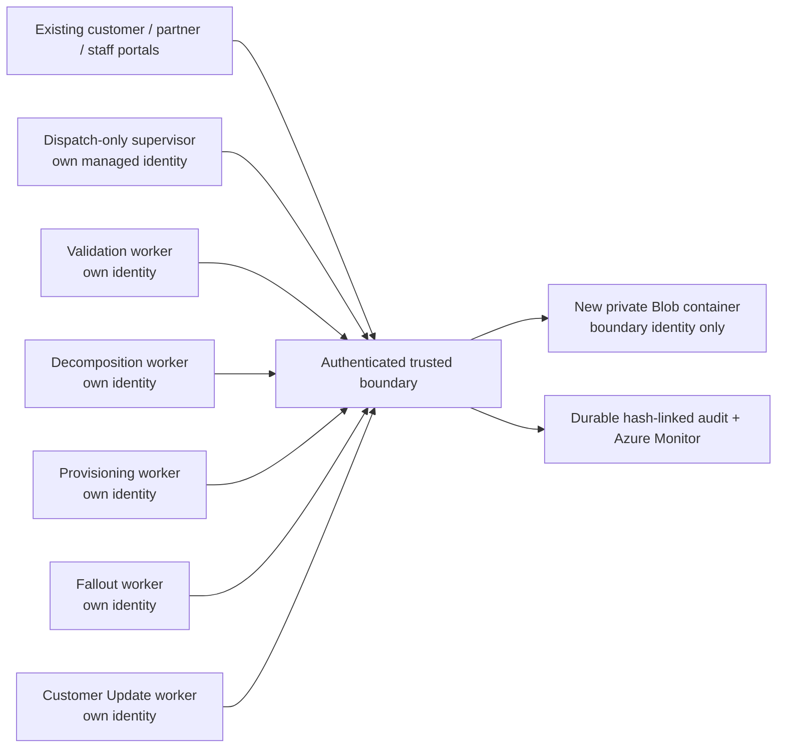

# Isolated agent copy (acceptance release)

This is a **new application/state/Azure stack**, not an upgrade of either published application.
The token app `ama30-private-zm5qigrnxeyay` in `rg-ama30-admin-202611051251` and SSO app
`ama30-private-nbfy3ijurs3j2` in `rg-ama30-sso` are not deployment targets. Do not copy their data,
settings, credentials, registrations, or managed identities. Retirement needs later user acceptance
and explicit authorization. Nothing in this runbook authorizes retirement or GitHub publication.

## Runtime and authority



Seven separate Container Apps have exactly one user-assigned managed identity each: the five workers,
dispatch supervisor, and trusted boundary. They share an image, **not a runtime or credential**.
Only `app.isolated.api:app` is exposed; it imports endpoint contracts without running the old
`app.main` lifespan, supervisor, benchmark advance loop, SQL bootstrap, or default credential store.
Every worker runs `python -m app.isolated.runtime` with an explicit `ManagedIdentityCredential(client_id=...)`.
No worker has portal tokens, storage credentials, SQL settings, approval credentials, or another identity.
The boundary's `/internal/identity` independently verifies the acquired identity before a runtime starts work.
The boundary also attests its own acquired Entra application token against its configured principal/client IDs,
with no worker application roles. Policy holds/reminders are attributed to this trusted boundary identity,
with the independently verified initiating caller recorded separately; supervisor dispatch does not impersonate
a provisioning or customer-update worker.

These deterministic workers compute bounded proposals. They **do not independently write state or
provision a real network**. The boundary compares each proposal with freshly recomputed facts, checks
the next durable event and agent stage, and calls the existing guarded domain transition atomically.
There is no API accepting arbitrary state, claimed agent identity, arbitrary recovery tools, or approval
flags. L3/L4 are autonomy descriptions, not Azure roles.

| Verified runtime | Receiving API permission | Facts available | Forbidden |
|---|---|---|---|
| Supervisor | `POST /internal/dispatch` | Pending dispatch counts | Worker contracts/results, approval, provisioning, direct state |
| Validation | `validation.submit` | Relevant site, catalogue bandwidth, capacity | Plans, activation, recovery, approval |
| Decomposition | `plan.create` | Validated catalogue service/resource specifications | Other orders, activation, approval |
| Provisioning | `reserve.activate` | Policy-authorized service/resource plan | Arbitrary allocation amounts, exception approval, recovery |
| Fallout | `recovery.retry-once` | Allowlisted timeout and attempt count | Any other playbook, second recovery, approval |
| Customer Update | `notification.queue` | Customer-safe synthetic status/order ID | Provisioning, approval, customer/account directory |

All five workers use `GET /internal/work` to read only their own next contract and `POST /internal/submit`
with `eventId`, `operation`, `revision`, and `proposal`. Identity is exclusively the verified Entra
`oid` + `azp` binding, not a field/header. The API accepts only RS256 signatures from the tenant's Entra
JWKS, its exact v2 issuer/audience/tenant, valid `exp`/`nbf`/`iat`, and the identity's single assigned
application role. Delegated scopes, wrong roles, unknown principals, unsigned tokens, another tenant,
and `X-Agent-*`/`X-Principal-Id` assertions are rejected.

## Two authorization layers

Azure RBAC grants each worker and supervisor **AcrPull only at the new registry**. No worker has
state-store data-plane permissions. The boundary has Storage Blob Data Contributor at the **new
`boundary` container**, not subscription/resource-group/account scope. Public Blob access and shared
keys are disabled; a private endpoint and private DNS connect only this new network.

Application roles `Worker.validation`, `Worker.decomposition`, `Worker.provisioning`, `Worker.fallout`,
`Worker.customer_update`, and `Worker.supervisor` exist on a new single-tenant tools application.
They are assigned only to the matching managed identity. These tool application roles do not confer
Azure resource RBAC, staff roles, or exception-approval authority.

The new acceptance copy uses Blob ETag compare-and-swap, not SQL. Consequently no SQL user/grant is
required or assigned to workers. Reusing Azure SQL later would require explicit database users and
narrow database grants; Azure RBAC alone would not authorize SQL queries. Do not enable the legacy
SQL store/bootstrap or distribute an unrestricted SQL credential.

## Policies, UX and persistence

The five-step case study, customer/partner accounts and tracking, staff console, bilingual messages,
enterprise approvals, Analytics and audit exports reuse their existing contracts/assets. Staff orders
in the isolated copy always go through the enterprise picker and await that enterprise's approval.
Staff cannot submit a wholesale order through MCP; authenticated partners retain their own channel.
Customer ownership checks remain on the account APIs. Only synthetic `Demo ...` companies are accepted.
Registration, password resets, approval mail, notifications and network/partner provisioning remain
explicit simulations; no existing account or live data is imported.

Invalid sites wait for correction; empty capacity cannot be invented by approval. Risk and closed
change-window holds are imposed by the boundary before a provisioning plan is exposed. Capacity
and the seven-day deadline are rechecked at commit. Recovery permits exactly one allowlisted simulated
partner-timeout attempt. SLA review and exception decisions require an authenticated service manager,
not supervisor/worker identity. Rejection compensates any synthetic reservation through the trusted policy.

Events, dispatches, proposals' committed receipt fingerprints, orders, allocations and notifications
are durable in a single atomic snapshot. ETag conflict retries reload facts and recompute the entire
transaction. A stale proposal is denied, not silently applied. An identical replay returns its durable
receipt; a changed replay is denied. Crash-before-commit rolls back; lost-response/worker restart does
not duplicate capacity or customer messages. Idle polling and reads do not rewrite the snapshot.

Analytics benchmarks also use the six remote runtime contracts and an independent synthetic order
book. Unlike the old timed benchmark's simulated manager, **no automatic approval is performed**.
The isolated Analytics view lists benchmark holds with manager-only approval/rejection/site-confirmation
buttons. `GET /api/isolated/benchmark/holds` and
`POST /api/isolated/benchmark/orders/{id}/decision` support the same review for scripts. Benchmark
customer correction applies only to manager-owned synthetic fixture orders, not real customer orders.
Measured times include the explicit review delay. No synthetic benchmark result proves production KPIs.

Azure OpenAI remains an optional advisory-only integration in the reused API. This template does not
create/enable an OpenAI deployment or use either old app's keys/endpoints. If later enabled with a new
resource, give only the boundary narrow inference permission; model output has no execution authority.

## Provisioning

Use the existing authorized Azure CLI account/subscription. Do not change Windows execution policy,
purchase licenses, grant tenant-wide admin consent, bypass subscription policy, or access old settings.
`scripts/Deploy_Isolated.py` is the cross-platform entrypoint and runs from PowerShell without
changing its script execution policy.

```powershell
python -m pip install -e ".[dev]"
az bicep build --file infra\isolated.bicep --stdout | Out-Null
python scripts\Deploy_Isolated.py `
  --subscription <existing-authorized-subscription-id> `
  --resource-group rg-amai-<new-unique-acceptance-name> `
  --receipt <new-private-receipt-path> `
  --credentials <new-private-credentials-path>
```

The script refuses an existing resource group and existing receipt/credential files. It creates new
infrastructure/identities first, then a dedicated tools app/service principal and six narrowly scoped
app-role assignments, builds a new image, and deploys the seven apps. Application registration/role
assignment requires the existing caller's directory authorization. It requests no delegated permissions,
admin-consent bypass, static agent secrets, or broad role grants. Failures preserve a nonsecret receipt
with the new resource group, completed stages and blocker; partially created resources are left for
authorized inspection, never silently deleted. The portal credentials file is private and must never
be committed/shared. It contains newly generated staff/partner/session secrets, not agent credentials.

To resume only the app-deployment stage after a partial failure, use the same new receipt/credential
paths and `--resume --image-tag <explicit-existing-new-registry-tag>`. Resume checks the new group's
`isolated-agent-acceptance` tag and original authorized tenant/subscription; it does not recreate
directory roles/identities, change credentials, or target an old stack.

This is billable infrastructure: seven minimum-one replicas, registry, private endpoint, storage,
logs and Application Insights. There is no hard cost cap; the old stacks/budgets are unchanged.
Review the new group's costs/retention and obtain any further needed budget authorization.
Azure policy, quota, location, registration or assignment failures are blockers, not permission to
use a different tenant/subscription or old stack.

## Operational verification

```powershell
python -m pytest tests\test_isolated.py tests\test_isolated_process.py -q
python -m ruff check app\isolated tests\test_isolated*.py tests\isolated_process.py scripts\Deploy_Isolated.py scripts\Verify_Isolated.py
python scripts\Verify_Isolated.py --receipt <new-receipt> --credentials <new-credentials> --output <new-nonsecret-verification-report>
```

Local process verification starts a real boundary plus six separate HTTP client processes, uses
synthetic RSA-signed test tokens and temporary isolated SQLite state, and checks the recovery journey
and verified principal audit. Its test issuer is injected **only by the test harness**, never shipped
in the image. Local tokens are not evidence of Azure managed identity acquisition or Azure RBAC.

On Azure, each runtime performs receiving-API identity attestation, denial when requesting another
worker's unattached managed identity, cross-agent/approval/spoofing denials,
a real wrong-audience managed-identity token rejection, and a **403 on direct reading of the new Blob
state with its own identity**. Inspect every app's `identity.verified`, `isolation.storage-denied` and
`isolation.verified` logs. Declared Bicep identities, container attachment, or empty health responses
alone are insufficient. Confirm the actual principal/client IDs equal the receipt bindings.

`GET /isolated-health` checks the boundary's state connectivity; it is readiness, not pipeline evidence.
`GET /health` separately reports all six recently authenticated runtime heartbeats and becomes degraded
when one stops. Check again after more than 60 seconds; never refresh a fake legacy worker timestamp.
Create new synthetic orders and inspect outcomes, audit attribution, idempotent replays and nonduplicated
allocation/notifications. Restart only a runtime in this new group and confirm durable resume.
The live verifier submits its own synthetic recovery order and restarts the new provisioning revision,
then requires fresh receiving-API identity attestation, completed recovery and one allocation. It checks
all seven image bindings, narrow actual RBAC, startup denial receipts, the boundary's Entra-attested
principal and an unchanged idle snapshot after 65 seconds. Its nonsecret report is saved incrementally;
a failed check leaves an explicit blocked receipt, not a success result. The restart proves recovery
across an actual runtime restart, not a crash at a specific Blob commit instruction.

Durable audit includes verified principal ID, agent/version, order/correlation IDs, operation,
authorization and outcome for commits/denials/meaningful dispatch/identity events. Failed validation
has no verified principal and is explicitly recorded as invalid credential. Tokens are never recorded.
Successful idle polls use heartbeat counters and normal diagnostics, not an append per poll.
Per-poll HTTP console logs are suppressed; automatic request traces are sampled at 10%, while
explicit authorization/commit/identity/denial logs remain unsampled.
`azure-monitor-opentelemetry` exports structured logs to this new Application Insights/Log Analytics
workspace. Query both application traces and container console logs; hash-linked Blob audit is durable
but is not WORM or a regulatory-compliance certification.

```kusto
ContainerAppConsoleLogs_CL
| where ContainerAppName_s startswith "amai-"
| where Log_s has_any ("identity.verified", "isolation.verified", "isolation.storage-denied")
| project TimeGenerated, ContainerAppName_s, Log_s
```

## Optional Microsoft Agent 365 governance

Yes: Agent 365 can govern these agents **in addition to**, not instead of, resource RBAC and receiving
API business authorization. It is **not enabled by this deployment**. Managed identities are not
automatically Entra Agent ID identities/Agent 365 registrations; Application Insights alone is not
Agent 365 governance.

Current Microsoft Learn guidance supports existing Python agents and background **S2S** authentication.
Use one agent blueprint per differently privileged credential boundary, each federated to that worker's
own managed identity, with a named sponsor and separate registered agent identity. Do not share one
blueprint credential able to impersonate all five. Keep the tools' verified acting principal bindings
explicit; governance metadata must never be trusted as an authorization claim. Agent ID identity
changes require reviewing the exact caller identity for both Azure RBAC and the tools allowlist.
Blueprints cannot hold Azure RBAC. Where a registered Agent ID is the acting resource caller,
assign narrow permissions directly to that agent identity, not its blueprint. Background S2S workers
do not require mailbox/user accounts.

The tenant must have Agent 365 enabled; setup needs Global Administrator or Agent ID Developer with
an administrator completing needed OAuth grants. Read-only portfolio evidence reports an Enabled
`MICROSOFT_365_E7_NO_TEAMS` SKU with one consumed unit; that is licensing evidence, **not tenant
enablement, registration authority or delivered telemetry**. No licenses/tenant grants are purchased
or changed here.
Additional read-only checks found `Global Reader` as the current CLI user's direct directory role
and no entries in the first-page Agent Identity Blueprint query. The beta blueprint API is readable,
but that does not prove Agent 365 tenant enablement, permission to register agents, eligible/PIM roles,
or working governance/export. No Agent ID Developer or Global Administrator direct assignment was
observed, and registration was not attempted without separate authorization.

For a separately authorized integration, use Microsoft OpenTelemetry Distro (not the deprecated Agent
365 Observability SDK) with root `invoke_agent` spans, the matching registered agent/tenant attributes,
and an agent-aware app-only token resolver:
`use_microsoft_opentelemetry(enable_a365=True, a365_use_s2s_endpoint=True, a365_token_resolver=...)`.
Default delegated export is inappropriate for these background blueprint/S2S workers. Configure Azure
Monitor and Agent 365 destinations independently. Verify telemetry actually arrives under each of the
five registered identities and denial/approval policies remain enforced before describing governance
as active. Registration, sponsor assignments and any OAuth grants require explicit authorization.

Authoritative references (checked 23 November 2026):

- [Connect an existing agent / prerequisites and licenses](https://learn.microsoft.com/en-us/microsoft-agent-365/developer/get-started)
- [Agent identity / blueprint credential boundaries](https://learn.microsoft.com/en-us/microsoft-agent-365/developer/identity)
- [Choose integration option](https://learn.microsoft.com/en-us/microsoft-agent-365/developer/choose-integration-option)
- [Microsoft OpenTelemetry / S2S export](https://learn.microsoft.com/en-us/microsoft-agent-365/developer/microsoft-opentelemetry)

## Acceptance gates

Keep evidence categories separate: passing local contracts/policy/concurrency tests, compiled Bicep,
deployed resources, acquired/verified Azure identities, actual RBAC/tool denials, pipeline outcomes,
telemetry delivery, browser/UX acceptance, and optional Agent 365 registration/export.
A partial deployment or missing tenant permission is reported as blocked, never as an accepted app.
User acceptance, representative operational pilot, Türkiye residency/production compliance, real
carrier integration, and retiring either old stack remain future work.

### Verified isolated deployment: 23 November 2026

The separate synthetic acceptance copy is deployed and operational:
[open the new application](https://amai-boundary-5h5zbw727ae4o.lemonstone-04b0ee3b.swedencentral.azurecontainerapps.io)
or [its five-step case study](https://amai-boundary-5h5zbw727ae4o.lemonstone-04b0ee3b.swedencentral.azurecontainerapps.io/case-study).
Its resource group is `rg-amai-isolated-20261123` in Sweden Central. All seven apps use
`amai:isolated-reviewed-20261123`, built from application commit
`f9af950c7898bf2e5f0f77fcb9c409ad1a0675d7`, with digest
`sha256:701a7e406f372791f4f693a567e4c21f03320a4873b31a73c7598aa837e4557e`.
Operational verifier/documentation updates do not change that deployed application image.

The live verifier passed actual single-identity attachment, receiving-API identity/denial probes
for all five workers plus supervisor, registry-only worker RBAC, and container-scoped boundary
data permissions. Synthetic recovery order `AMA-9DD113308B` completed after a provisioning-runtime
restart and fresh identity attestation, with one retry, one allocation, all five principal-attributed
agent commits and idempotent intake replay. All six heartbeats remained healthy and the public state
snapshot, allocations, notifications and tool audit stayed unchanged during the 65-second idle check.
Application Insights delivered all five agents' operation, verified principal, version, authorization,
outcome and correlation evidence for that order; container diagnostics also delivered startup denials.

Customer browser checks passed registration, simulated-code verification, profile and password
sign-in. Partner checks passed a manually shared synthetic invitation, password sign-in and
Deliveries/Payments/Concerns/Account views, with no JavaScript errors. Only fresh synthetic customer
and partner fixtures were added; these UI checks created no orders and sent no email. Independent
coordinator checks covered staff sign-in, Analytics, Trust & governance, all five agent views, the
five-step case study and unchanged configuration/revisions/sign-in modes of both original stacks.

Nonsecret receipts remain in the private session artifacts: `isolated-deployment.json`,
`isolated-verification.json`, `isolated-diagnostics.json`, `isolated-customer-partner-browser.json`
and `agent365-prerequisites.json`. Newly generated portal credentials are separate private files;
never commit, publish or paste their values. Local core verification passed 99 tests; the subsequent
isolated/approval/account regression selection passed 85 tests (overlapping selections, not additive).
Bicep compilation and JavaScript syntax checks passed.

Implementation/deployment verification is **not user business acceptance or production approval**.
Agent 365 remains **not registered/not active**, despite the assigned-E7 prerequisite evidence.
Tenant enablement, authorized registration/sponsors and verified per-agent S2S telemetry remain
separate future gates. Real carrier/email/SMS operations, Türkiye compliance, representative pilot,
cost acceptance and any retirement of an original stack require further explicit authorization.
The original stacks and original local main checkout were not modified; no GitHub push or PR was made.
