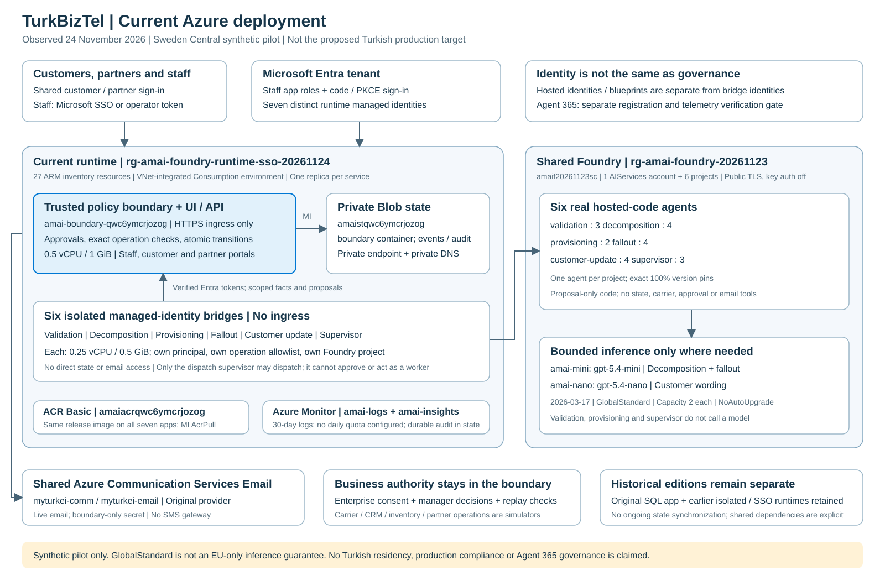
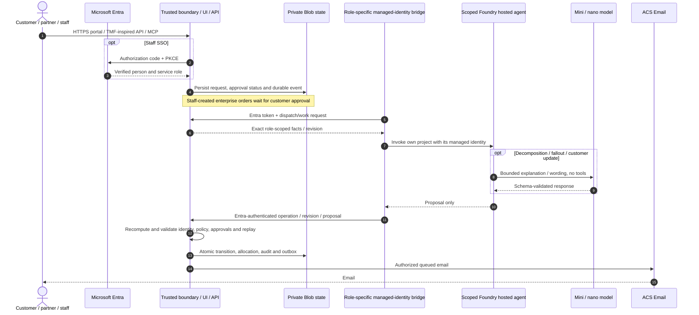

# Current Azure architecture

**Observed 24 November 2026, after the unified release.** This is the deployed
Foundry dual-login application, not the proposed Turkish production target and
not the [historical single-app SQL estate](legacy-azure-architecture.md).
Azure inventory, running revisions, RBAC, network settings, model deployments and
health were read directly with Azure CLI and the application health endpoints.
No tenant grants, application data or runtime settings were changed to produce
this inventory.

[Open application](https://amai-boundary-qwc6ymcrjozog.mangosand-20d8d735.swedencentral.azurecontainerapps.io)
| [Interactive story](https://amai-boundary-qwc6ymcrjozog.mangosand-20d8d735.swedencentral.azurecontainerapps.io/case-study)
| [Current source release](https://github.com/m-haider-raza/AMA-Telecom-Order-to-Activation/commit/998988911b04b11afb2298431b3e31e42e891496)



**Download:** [SVG diagram](images/current-azure-architecture.svg) |
[PNG diagram](images/current-azure-architecture.png).
The diagram distinguishes Azure resources, hosted data-plane agents and tenant
identity services; these are not all ARM resources.

## At a glance

| Area | Currently deployed |
|---|---|
| Runtime group | `rg-amai-foundry-runtime-sso-20261124`: 27 ARM resources returned by `az resource list`, including a private-endpoint NIC, DNS link and policy-created resources |
| Shared AI group | `rg-amai-foundry-20261123`: 7 ARM resources (one AIServices account and six projects). Hosted-agent versions and the two model deployments are inventoried separately, not added to that count |
| Region | Sweden Central. The `GlobalStandard` inference deployments do **not** guarantee processing only in Sweden or the EU |
| Compute | Seven Container Apps in `amai-environment`: one boundary/API/UI plus five task bridges and one dispatch-supervisor bridge. Each has one replica, min=max=1 |
| State | Private Azure Blob Storage, `amaistqwc6ymcrjozog`, container `boundary`. Only the boundary identity has data access. **Azure SQL is not the system of record for this edition** |
| AI execution | Six real hosted-code agents in six Foundry projects. Three roles use no model; mini/nano add bounded explanation/wording, never execution authority |
| Human access | Customer/partner email-password login; staff Microsoft Entra SSO with service roles or a distinct ServiceOperator token fallback |
| Outbound delivery | Live Azure Communication Services Email through the original shared provider; SMS is not configured. Telecom/CRM/partner provisioning remains simulated |
| Governance | Azure RBAC, receiving-API operation allowlists, enterprise/manager approvals, hash-linked audit and Azure Monitor. Agent 365 registration/export is **not active**; see [latest retry](AGENT365-STATUS.md) |

## Resource inventory and ownership

| Resource / artifact | Name | Actual role and boundary |
|---|---|---|
| Container Apps environment | `amai-environment` | Consumption profile, external environment integrated with VNet subnet `amai-network/apps`; not zone redundant |
| Boundary Container App | `amai-boundary-qwc6ymcrjozog` | Only public HTTPS ingress, port 8000. Serves shared login, staff/customer/partner APIs, story, decks and videos; verifies agent tokens; owns state, approvals and email outbox |
| Six bridge Container Apps | See table below | No ingress. Poll/dispatch through the boundary using distinct managed identities, invoke only their scoped Foundry project and return proposals |
| Container Registry | `amaiacrqwc6ymcrjozog` | Basic SKU, public endpoint, admin user disabled. All seven identities have registry-scoped AcrPull |
| State account | `amaistqwc6ymcrjozog` | Standard_LRS, TLS 1.2, public network and shared-key access disabled, anonymous Blob access disabled |
| Network | `amai-network`, `amai-state-endpoint` | VNet-integrated apps; approved Blob private endpoint; private DNS zone `privatelink.blob.core.windows.net` and VNet link `amai-storage` |
| Network policy artifacts | Two `amai-network-*-nsg-swedencentral` NSGs; endpoint NIC | Present in live inventory. Their presence alone does not establish a restrictive egress policy |
| Managed identities | `amai-boundary-identity` plus `amai-{agent}-identity` for each bridge | Seven separate user-assigned managed identities. Boundary state permissions and individual project-consumer permissions are not shared |
| Monitoring | `amai-logs`, `amai-insights` | Log Analytics (30 days, PerGB2018) and Application Insights. Workspace daily quota is `-1` (no configured daily cap), **not the old estate's 0.1 GB/day cap** |
| Policy-created storage artifact | Event Grid system topic on the state account | Present in inventory; not the order workflow/event queue |
| Foundry account | `amaif20261123sc` in `rg-amai-foundry-20261123` | AIServices S0, local/key authentication disabled, public TLS endpoint enabled |
| Foundry projects | `validation`, `decomposition`, `provisioning`, `fallout`, `customer-update`, `supervisor` | One hosted-code agent per project. Each bridge has Foundry Agent Consumer only on its own project |
| Models | `amai-mini`, `amai-nano` | `gpt-5.4-mini` and `gpt-5.4-nano`, version `2026-03-17`; GlobalStandard, capacity 2 each, NoAutoUpgrade |
| Shared email resources | `myturkei-comm`, `myturkei-email`, `AzureManagedDomain` in `rg-ama30-admin-202611051251` | Existing global ARM resources reused for the approved email provider. The connection string is a boundary-only Container Apps secret, not a worker credential |
| Tenant staff application | Entra app/client ID `bfc91fcb-9c7d-4ed0-a239-e911060a6349` | Tenant-specific authorization-code/PKCE flow; ServiceManager, ServiceOperator and ServiceAuditor app roles. This is separate from agent identity |
| Hosted identity artifacts | Six active Foundry-managed hosted identities and six associated agent blueprints | Verified in Foundry metadata and Graph; identifier table in [Agent 365 status](AGENT365-STATUS.md). Separate from seven runtime managed identities and catalog registrations |

The runtime and shared AI groups are in subscription
`9f674eb0-b40e-475d-bf85-a2a53238f25b`, tenant
`6828d9b6-f0ce-43c7-9e56-14bc61a6b93c`.
The original SQL app and earlier isolated/SSO/Foundry runtime groups remain
separate historical deployments; the current app does not synchronize their data.
Shared email and hosted agents are deliberate dependencies, not copies.

## Deployed compute and agent versions

All seven apps run image
`amaiacrqwc6ymcrjozog.azurecr.io/amai:foundry-sso-20261124-complete-release`,
digest `sha256:d04cf7e30626623a6b1735b6e5017a4fd48d14dd23ac4f85ff31e9b45c7398c5`.
The boundary uses 0.5 vCPU / 1 GiB; each bridge uses 0.25 vCPU / 0.5 GiB
(2 vCPU / 4 GiB configured total, **excluding hosted-agent compute**).

| Runtime Container App | Ready revision suffix | Hosted agent / pinned version | Inference role |
|---|---|---|---|
| `amai-boundary-qwc6ymcrjozog` | `0000014` | None | Authoritative state/approval boundary, not a sixth specialist |
| `amai-validation-qwc6ymcrjozog` | `0000005` | `amai-validation:3` | Deterministic scoped validation; no model |
| `amai-decomposition-qwc6ymcrjozog` | `0000005` | `amai-decomposition:4` | Deterministic decomposition plus mini explanation |
| `amai-provisioning-qwc6ymcrjozog` | `0000005` | `amai-provisioning:2` | Deterministic simulated allocation proposal; no model |
| `amai-fallout-qwc6ymcrjozog` | `0000005` | `amai-fallout:4` | Allowlisted recovery proposal plus mini explanation |
| `amai-customer-update-qwc6ymcr` | `0000005` | `amai-customer-update:4` | Nano customer-safe wording; boundary controls delivery |
| `amai-supervisor-qwc6ymcrjozog` | `0000005` | `amai-supervisor:3` | Dispatch pending work; no model, worker-operation or human-approval authority |

Hosted source ZIP SHA-256:
`997c0039a906626b81ff714c5464051182b003d9743072895a8fd4c7bbfc524b`.
All six endpoints retain 100% FixedRatio routing to those reviewed versions.
An active/ready hosted version is not proof of running billable sessions.
Normal completion uses one mini and one nano call; a recovered timeout adds one
mini call. Supervisor batching is not an invented per-order model call.

## Runtime flow and trust boundaries



Events/outbox are persisted application state, not Azure Service Bus, Event Grid
order messages or Durable Functions. Bridges make outbound calls; "no ingress"
does not mean an internal worker web service.
Only the boundary commits business transitions. Foundry code has no direct
state, approval, carrier or email tools. `/health` confirms all six recent runtime
heartbeats; this does not by itself prove a new model invocation or inbox receipt.

## Network, identity and access

| Path | Transport and authorization |
|---|---|
| Browser to boundary | Public HTTPS; no WAF is claimed. Shared customer/partner sign-in; staff SSO or distinct operator fallback. Tab-scoped sessions preserve role separation |
| Bridge to boundary | Public TLS boundary endpoint plus audience/tenant/application-role/principal-verified Entra tokens; exact operation allowlists. No implicit trust from caller-supplied agent names |
| Boundary to state | Approved Blob private endpoint and private DNS; managed identity, container-scoped Storage Blob Data Contributor |
| Bridge to Foundry | Public TLS data plane; own-project Foundry Agent Consumer. No cross-project role or state Blob role |
| Container Apps to ACR | Managed identity and registry-scoped AcrPull; no registry admin credentials |
| Boundary to ACS | Public TLS plus boundary-only secret reference; no ACS connection string is distributed to workers |
| Runtime to monitoring | Azure Monitor / Log Analytics and Application Insights, plus business audit in state. Agent 365 export is not implied |

The boundary has only AcrPull and its Blob-container data role in the inspected
runtime RBAC. Each bridge has only AcrPull and its own Foundry project Consumer
role. Tenant directory roles, Entra app-role assignments and platform-hosted
identity permissions are separate checks, not interchangeable with Azure RBAC.

## Current gaps and data residency

- **Not production-localised.** Synthetic Sweden Central pilot with GlobalStandard
  mini/nano inference. It is not a KVKK/BTK compliance claim or an EU-only inference
  guarantee. The production-target deck places customer data, inference, audit and
  operational dependencies in Türkiye; that Azure Local target is not deployed.
- **Not highly available.** One replica per service, no environment zone
  redundancy, Standard_LRS state. No production recovery objective is claimed.
- **Public endpoints remain.** Boundary, ACR Basic and Foundry use public TLS.
  State is private; that does not make the entire application private.
- **Secrets remain Container Apps references.** No Key Vault integration is
  claimed. Never expose session keys, staff tokens or ACS connection strings.
- **Monitoring costs differ from the legacy estate.** Seven runtime apps, six
  hosted agents, models, registry, state, logs and email all contribute. The old
  single-app US$80 estimate and 0.1 GB/day log cap do not describe this edition.
  See the [Foundry economics deck](presentations/TurkBizTel-Foundry-Model-Economics.pdf)
  for clearly bounded model-cost assumptions, not a complete Azure invoice.
- **Agent 365 is a separate gate.** Foundry registration, managed identities and
  Azure Monitor do not prove Agent 365 catalog visibility or delivered S2S spans.
  The 24 November catalog POST returned HTTP 403; the current token lacks
  registration-write scope and the user has Global Reader. Existing hosted
  identities/blueprints are active; no duplicate objects were created.
  See [the dated registration status and administrator action](AGENT365-STATUS.md).

## What the repository can and cannot reproduce

`infra/isolated.bicep` describes the isolated infrastructure;
`scripts/Deploy_Foundry_App.py` adds the current dual-login/hosted-project
configuration for a **new** deployment. `scripts/Deploy_Foundry*.py` provision
hosted agents/models with reviewed source hashes and exact version pins.
`app.isolated.api:app` is the current web entry point; local `app.main:app`
remains the compact legacy/demo edition.

The latest application release was a reviewed image overlay preserving the
existing runtime dependencies and configuration; it was applied to all seven
services. Do not blindly replay a bootstrap template or recreate SSO, credentials
or state to publish documentation. Foundry project bindings, operator fallback,
live-email settings and narrow identity roles must survive any subsequent update.

## Verify it yourself

Read-only PowerShell examples; no token, secret or message content is printed:

```powershell
$subscription = '9f674eb0-b40e-475d-bf85-a2a53238f25b'
$runtime = 'rg-amai-foundry-runtime-sso-20261124'
$foundry = 'rg-amai-foundry-20261123'

az resource list -g $runtime --subscription $subscription --query "[].{name:name,type:type,location:location}" -o table
az resource list -g $foundry --subscription $subscription --query "[].{name:name,type:type}" -o table
az containerapp list -g $runtime --subscription $subscription --query "[].{name:name,image:properties.template.containers[0].image,ready:properties.latestReadyRevisionName}" -o table
az storage account show -g $runtime -n amaistqwc6ymcrjozog --subscription $subscription --query "{publicNetworkAccess:publicNetworkAccess,sharedKey:allowSharedKeyAccess}" -o json
az monitor log-analytics workspace show -g $runtime -n amai-logs --subscription $subscription --query "{retention:retentionInDays,dailyQuotaGb:workspaceCapping.dailyQuotaGb}" -o json

$origin = 'https://amai-boundary-qwc6ymcrjozog.mangosand-20d8d735.swedencentral.azurecontainerapps.io'
Invoke-RestMethod "$origin/health"
Invoke-RestMethod "$origin/isolated-health"
```
