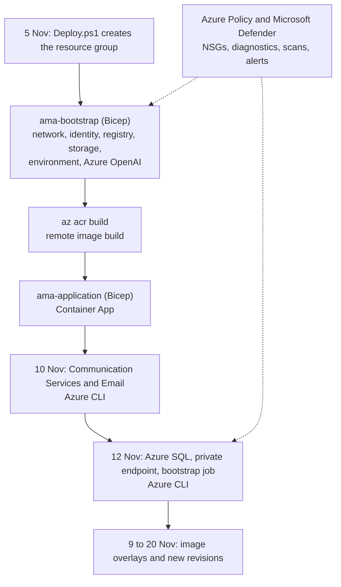
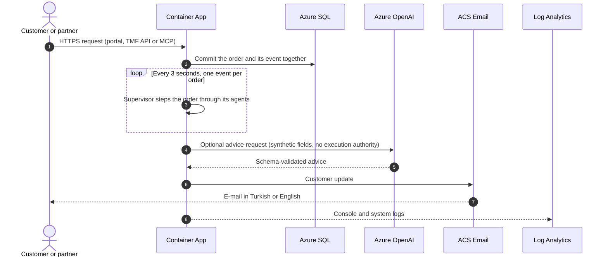

# Azure architecture

How the TürkBizTel order-to-activation demonstrator is built on Azure, and how each service came to exist. Everything below was observed **read-only** with the Azure CLI on 20 November 2026 (resource configuration, deployment history and the Activity Log). Nothing was changed in Azure while preparing this page.


*Vector version: [azure-architecture.svg](images/azure-architecture.svg). Icons: Microsoft Azure Architecture Icons (V25), used under Microsoft's icon terms.*

## At a glance

- **One dedicated resource group** in Sweden Central, tagged as a synthetic demo and with no resource locks. It holds 25 resources. A platform-managed group next to it holds the Container Apps load balancer and public IP.
- **Compute.** One Azure Container Apps app (consumption profile, a single 0.25 vCPU / 0.5 GiB replica) in an environment integrated into a virtual network. The only public entry point is its HTTPS ingress.
- **Data.** Azure SQL Database (Standard S0) is the system of record. A Blob container keeps the legacy snapshot that seeds SQL on first start. The app reaches both through private endpoints.
- **AI.** One Azure OpenAI deployment (`gpt-4.1-mini`) acts as an advisor. It has no execution authority and only ever receives synthetic fields.
- **Identity.** A user-assigned managed identity. There are no storage keys, no registry admin user, no SQL passwords and no OpenAI keys.
- **Customer updates.** Azure Communication Services Email. SMS is not connected.
- **Operations.** Log Analytics (30 days, 0.1 GB a day cap), a US$100 monthly budget with alerts, and Microsoft Defender plans at subscription level.
- **Residency.** Azure has no region in Türkiye, so this deployment holds synthetic data only. The production design keeps customer data on Azure Local inside Türkiye. See [Data residency](#data-residency).

## Resource inventory

| Layer | Resource | Service and SKU | Key settings | Created by (UTC) |
|---|---|---|---|---|
| Compute | `ama30-private-environment` | Container Apps environment, Consumption profile | Integrated into subnet `container-apps`, external, not zone redundant, mTLS off, logs to Log Analytics | `ama-bootstrap`, 5 Nov 12:55 |
| Compute | `ama30-private-zm5qigrnxeyay` | Container App | Single-revision mode, container `activation`, 0.25 vCPU / 0.5 GiB, min = max = 1 replica, HTTPS ingress to port 8000 (`allowInsecure` off), liveness, readiness and startup probes on `/health`, image pulled with the managed identity, four Container Apps secrets | `ama-application`, 5 Nov 13:02. New revisions since, by `az containerapp update` |
| Compute | `ama30acrzm5qigrnxeyay` | Container Registry, Basic | Admin user off, no anonymous pull, public endpoint, repositories `ama-activation` and `ama30` | `ama-bootstrap`, 5 Nov 12:52 |
| Data | `ama30-sql-zm5qigrnxeyay` and `ama30-db` | Azure SQL server and database, Standard S0 (10 DTU, 2 GB) | Microsoft Entra-only authentication, TLS 1.2 minimum, transparent data encryption, locally redundant backups, private endpoint. Public network access was still Enabled on 20 Nov, with four client-IP firewall rules (see [hardening item 1](#hardening-checklist-for-any-use-beyond-a-demo)). The system database `master` is listed too | Azure CLI, direct writes, 12 Nov 20:30 to 20:32 |
| Data | `ama30stzm5qigrnxeyay` | Storage account, StorageV2, Standard_LRS, Hot | Public network access disabled, shared-key access off, blob public access off, TLS 1.2 minimum, versioning, 7-day soft delete, private endpoint. One container, `orders` | `ama-bootstrap`, 5 Nov 12:52 |
| AI | `ama30-ai-zm5qigrnxeyay` | Azure OpenAI, S0 | Key authentication disabled (Entra only). Deployment `telecom-advisor` is `gpt-4.1-mini` 2025-04-14, Standard, capacity 1, no auto-upgrade | `ama-bootstrap`, 5 Nov 12:57 |
| Messaging | `myturkei-comm`, `myturkei-email` and `AzureManagedDomain` | Communication Services, Email Communication Service and an Azure-managed e-mail domain (global resources) | Data location Europe. SPF, DKIM and DMARC verified on the managed domain | Azure CLI, direct writes, 10 Nov 08:46 to 08:48 |
| Network | `ama30-network` | Virtual network, 10.245.0.0/24 | Subnets `container-apps` (/27, delegated to `Microsoft.App/environments`) and `private-endpoints` (/27) | `ama-bootstrap`, 5 Nov 12:52 |
| Network | `ama30-network-container-apps-nsg-swedencentral` and `ama30-network-private-endpoints-nsg-swedencentral` | Network security groups | One per subnet, no custom rules | A platform identity acting for subscription governance policy, 5 Nov 14:14. Not in the Bicep |
| Network | `ama30-blob-endpoint` and `ama30-sql-endpoint`, with their network interfaces | Private endpoints in subnet `private-endpoints` | Group IDs `blob` and `sqlServer`, both approved | Blob: `ama-bootstrap`, 5 Nov 12:52. SQL: Azure CLI, 12 Nov 20:33 |
| Network | `privatelink.blob.core.windows.net` and `privatelink.database.windows.net`, linked by `ama30-network-link` and `ama30-sql-dns-link` | Private DNS zones | A records point the storage and SQL names at their private endpoints inside the virtual network. DNS zone groups `blob` and `default` | Blob zone: `ama-bootstrap`, 5 Nov 12:52. SQL zone: Azure CLI, 12 Nov 20:34 to 20:35 |
| Identity | `ama30-identity` | User-assigned managed identity | Used by the app for registry pull, Blob, SQL and OpenAI | `ama-bootstrap`, 5 Nov 12:52 |
| Operations | `ama30-logs-zm5qigrnxeyay` | Log Analytics workspace, PerGB2018 | 30-day retention, 0.1 GB a day cap | `ama-bootstrap`, 5 Nov 12:52 |
| Governance | `ama30-monthly-demo-budget` | Budget at subscription scope | US$100 a month, alerts at 80% actual and 100% forecast. An alert, not a spending cap | `ama-bootstrap`, 5 Nov 12:52 |
| Security | Event Grid system topic on the storage account | Event Grid system topic | Carries Defender for Storage malware-scan events | Defender for Storage, 5 Nov 17:06 |
| Platform | `ME_ama30-private-environment_<resource-group>_swedencentral` | Platform-managed resource group | Standard load balancer `capp-svc-lb` and public IP `capp-svc-lb-ip` for the environment | Created and managed by Azure Container Apps |

Notes:

- `ama-bootstrap` and `ama-application` are the two ARM deployments that `scripts/Deploy.ps1` runs.
- The `myturkei-*` names belong to the e-mail resources created before the rebrand to TürkBizTel. Azure does not allow Communication Services resources to be renamed. E-mails go out from the Azure-managed domain's own address, so customers do not see these names.
- Times are UTC and come from the Activity Log. "Direct writes" means individual Azure CLI commands with no ARM deployment recorded.

## How the estate was created



| When (UTC) | Channel | What was created |
|---|---|---|
| 5 Nov 12:51 | Azure CLI, `scripts/Deploy.ps1` | The dedicated, tagged resource group |
| 5 Nov 12:52 to 12:57 | ARM deployment `ama-bootstrap` (Bicep, `deployApp=false`) | Budget, managed identity, virtual network, registry with its AcrPull role, Log Analytics, storage account with its Blob role and the `orders` container, the blob private DNS zone, private endpoint and VNet link, the Container Apps environment, the Azure OpenAI account with the `telecom-advisor` deployment and its role |
| 5 Nov, between the two deployments | `az acr build` | The `ama30` application image, built remotely in the registry (no local Docker) |
| 5 Nov 13:02 | ARM deployment `ama-application` (same template, `deployApp=true`) | The Container App |
| 5 Nov 13:11 | Azure Policy deployment | A diagnostic setting on the OpenAI account |
| 5 Nov 14:14 | Platform identity for governance policy | The two NSGs, with empty rule sets |
| 5 Nov 15:16 to 17:06 | Microsoft Defender for Cloud | Defender for AI on the OpenAI account. Defender for Storage with on-upload malware scanning, and its Event Grid system topic |
| 10 Nov 08:46 to 08:48 | Azure CLI, direct writes | Communication Services, the Email Service and its managed domain |
| 12 Nov 20:30 to 20:35 | Azure CLI, direct writes | SQL server and `ama30-db`, the SQL private endpoint, the `privatelink.database.windows.net` zone, its VNet link, A record and DNS zone group |
| 12 Nov 20:49 | Azure Policy | The SQL security alert policy |
| 12 Nov 21:49 | Azure CLI | A temporary Container Apps job, `ama30-sql-bootstrap`. It ran inside the environment, created the schema and the app's contained database user (`SELECT`, `INSERT`, `UPDATE` and `DELETE` on schema `ama` only), then was removed |
| 13 Nov 21:31 | Microsoft Defender for Cloud | The SQL vulnerability assessment |
| 9 to 20 Nov | `az acr build` overlays and `az containerapp update` | New images and Container App revisions for media, the TürkBizTel rebrand and agent naming. The latest ready revision is `ama30-private-zm5qigrnxeyay--tb-20261120104802`, which takes 100% of traffic |

### What the repository can and cannot reproduce

- The 5 Nov core was created by `scripts/Deploy.ps1` running `infra/main.bicep` with the private-network option (`-EnablePrivateStorage`): the virtual network, registry, storage account and its private endpoint, managed identity and roles, Log Analytics, Container Apps environment and app, Azure OpenAI and the budget. Both files are on `main`.
- The template also offers `enableSql` (`-EnableSql`), which describes a SQL layer equivalent in design to the running one: a private, Entra-only server and database, a private endpoint and a one-off bootstrap job. The running SQL layer was created by direct CLI commands on 12 Nov, not by the template.
- The e-mail resources (Communication Services, the Email Service and its managed domain) were created by direct CLI commands, and the two NSGs by governance policy. The template does not describe them.
- To update the running app, build a new image tag (`az acr build`) and point the Container App at it (`az containerapp update`). Re-running `Deploy.ps1` creates a new resource group with new credentials, not a copy of this estate. To approach it, pass `-Location swedencentral -EnableSql -EnableOpenAI -OpenAiModel gpt-4.1-mini -OpenAiModelVersion 2025-04-14` after confirming that model's availability and quota, then add the e-mail resources yourself.

## Runtime flow



- The supervisor and the five specialist agents run in process, in the single always-on replica. This is deliberate for a compact demonstration. Scaling to zero would strand queued work.
- The network, CRM, inventory and partner adapters are simulators. Activating an order does not provision a real service.
- On first start, if the SQL document is empty, the app imports the Blob snapshot once. After that the Blob copy is a stale backup.

## Network, identity and access

### Network paths

| Path | Route | Authentication |
|---|---|---|
| Visitor to app | Internet to the Container Apps ingress, HTTPS only. Public pages show synthetic data without sign-in. Staff pages, partner API calls and MCP need a signed-in session or a bearer token | Sessions and tokens, with their secrets held as Container Apps secrets |
| App to Blob | Private endpoint `ama30-blob-endpoint`, resolved through `privatelink.blob.core.windows.net` | Managed identity, shared keys disabled |
| App to SQL | Private endpoint `ama30-sql-endpoint`, resolved through `privatelink.database.windows.net` | Microsoft Entra token for the managed identity, so there is no SQL password |
| App to Azure OpenAI | Public endpoint over TLS | Managed identity, key authentication disabled |
| App to ACS Email | Public endpoint over TLS | Connection string held as a Container Apps secret |
| Container Apps to registry | Public endpoint over TLS | Managed identity, admin user disabled |

### Role assignments

| Principal | Scope | Access |
|---|---|---|
| `ama30-identity` | Container registry | AcrPull |
| `ama30-identity` | Storage account | Storage Blob Data Contributor |
| `ama30-identity` | Azure OpenAI account | Cognitive Services OpenAI User |
| `ama30-identity` | Database `ama30-db` | Contained database user with `SELECT`, `INSERT`, `UPDATE` and `DELETE` on schema `ama`. No DDL and no `db_owner` |

Every assignment is scoped to a single resource. The identity has nothing at resource-group or subscription scope.

## Security controls

### In place

- **Storage.** Public network access, shared-key access and anonymous blob access are all off. TLS 1.2 minimum, blob versioning, 7-day soft delete. Defender for Storage scans uploads for malware and discovers sensitive data.
- **SQL.** Microsoft Entra-only authentication, TLS 1.2 minimum, transparent data encryption, a private endpoint, a security alert policy and a vulnerability assessment.
- **Registry.** Admin user off, anonymous pull off, image pull with the managed identity. The Container App runs an immutable image digest.
- **OpenAI.** Key authentication off, the model version pinned with no auto-upgrade, Defender for AI enabled, and a diagnostic setting created by governance policy.
- **App.** HTTPS only, single-revision mode, health probes, and secrets kept out of the container image and the repository.
- **Subscription.** The Defender for Cloud plans enabled include Storage (V2), SQL servers, AI, Containers, Cloud Security Posture, Resource Manager, Key Vault, App Service, Virtual Machines and Cosmos DB.

### Hardening checklist for any use beyond a demo

1. **SQL network exposure.** The design is private-endpoint access, but on 20 Nov the deployed server had `publicNetworkAccess` **Enabled**, with four client-IP firewall rules of the kind the Azure portal adds for administration (the addresses are not published here). Set it to `Disabled` and delete those rules once administration no longer needs them. The app is unaffected, because it connects through the private endpoint. Check the current state with the commands in [Verify it yourself](#verify-it-yourself).
2. **SQL auditing.** Server auditing is off. Turn it on and send it to Log Analytics, or to an in-country sink in production.
3. **Registry exposure.** The Basic registry has a public endpoint. Private Link needs the Premium tier.
4. **Edge protection.** There is no web application firewall or IP restriction in front of the app. Add one, with rate limiting, before exposing it beyond a demo.
5. **NSGs.** Both groups have no custom rules. Add rules that match the intended flows.
6. **Availability.** One replica, no zone redundancy and locally redundant SQL backups. Nothing here is highly available.
7. **Secrets.** The four secrets live in Container Apps. Move them to Key Vault references.
8. **OpenAI path.** The endpoint is public, with key authentication off. Add a private endpoint if policy requires it.
9. **Budget.** The budget alerts but does not stop spending.

## Observability and cost

- **Logs.** Container Apps console and system logs go to Log Analytics, kept for 30 days. The 0.1 GB a day cap stops ingestion for the rest of a day once it is reached.
- **Health.** `/health` backs the liveness, readiness and startup probes.
- **Alerts.** Budget alerts at 80% actual and 100% forecast, plus Defender for Cloud alerts.

Estimated monthly cost, always on, from Azure list prices for Sweden Central on 13 November 2026, before credits, discounts and tax. It is a planning estimate, not a quote:

| Component | Basis | US$ a month |
|---|---|---|
| Container Apps | One 0.25 vCPU / 0.5 GiB replica, consumption plan, always on | 19.71 |
| Azure SQL Database | Standard S0, 2 GB | 14.72 |
| Private endpoints | Two, for Blob and SQL | 14.60 |
| Log Analytics | Up to 3 GB a month at the daily cap | 8.97 |
| Registry, private DNS, storage, e-mail | Basic registry, two private DNS zones and small items | 7.07 |
| Microsoft Defender for SQL | Free trial on this subscription, list price afterwards | 15.00 |
| **Total** | About US$65 while the Defender for SQL trial lasts | **80.07** |

## Data residency

The assignment requires all customer data and inference to stay in Türkiye. Microsoft's public geography inventory, checked on 30 October 2026, lists no Türkiye region. That is not a claim that Microsoft has no network or edge presence in the country. The deployed demonstrator therefore holds **synthetic data only**, and the application labels itself `productionCompliant: false` in its own state payload.

The production design is a proposal shown in the solution film. It is not deployed by this repository.

| Concern | Deployed demonstrator (Sweden Central) | Production target (Türkiye) |
|---|---|---|
| Hosting | Azure Container Apps | Azure Local at an operator-owned or approved Turkish datacentre, running the portal and API, supervisor, agents and OSS/BSS adapters in local VMs or containers |
| Customer data | Azure SQL, synthetic only | A local database and event system inside Türkiye |
| Inference | Azure OpenAI `gpt-4.1-mini`, advisory, synthetic fields only | An approved local model endpoint replaces it. Foreign Azure OpenAI stays disabled for customer payloads |
| Identity, secrets, logs, audit and backups | Managed identity, Container Apps secrets, Log Analytics and SQL backups, all in Sweden Central | Local identity, secrets management, logs and audit, and backup and disaster recovery |
| Container images | Azure Container Registry | Azure Container Registry may supply approved images. No customer data or secrets in the build context, image layers or registry |
| Platform management | Not applicable | Azure Arc sends management metadata, so assess what leaves the country. Arc alone is not a residency guarantee. Disconnected operations for Azure Local is the alternative |
| Telemetry | Log Analytics | Opt-in aggregate metrics through Azure Monitor, only after a re-identification review. No raw logs, order IDs, customer or site identifiers, prompts or traces |
| Customer payloads, prompts, raw logs and backups leaving Türkiye | Not applicable, synthetic data only | None by default |

Encryption, private endpoints and EU hosting do not by themselves establish Turkish localisation. Legal counsel and the operator's data protection officer decide the actual KVKK and BTK obligations. See the residency section of [PRODUCTION.md](PRODUCTION.md).

## Verify it yourself

These commands are read-only. They run in PowerShell with Azure CLI, signed in to the subscription that holds the estate. Names in `$rg` and below come from the [inventory](#resource-inventory).

```powershell
$rg  = "rg-ama30-admin-202611051251"
$app = "ama30-private-zm5qigrnxeyay"

# Inventory, deployments and the active revision
az resource list -g $rg --query "[].{name:name, type:type}" -o table
az deployment group list -g $rg --query "[].{name:name, state:properties.provisioningState, time:properties.timestamp}" -o table
az containerapp revision list -g $rg -n $app -o table

# Data and network posture
az storage account show -g $rg -n ama30stzm5qigrnxeyay --query "{publicNetworkAccess:publicNetworkAccess, sharedKey:allowSharedKeyAccess}" -o json
az sql server show -g $rg -n ama30-sql-zm5qigrnxeyay --query "{publicNetworkAccess:publicNetworkAccess, tls:minimalTlsVersion}" -o json
az sql server firewall-rule list -g $rg -s ama30-sql-zm5qigrnxeyay --query "[].name" -o tsv
az sql server audit-policy show -g $rg -n ama30-sql-zm5qigrnxeyay --query state -o tsv
az network private-endpoint list -g $rg --query "[].{name:name, status:privateLinkServiceConnections[0].privateLinkServiceConnectionState.status}" -o table

# AI and identity
az cognitiveservices account deployment list -g $rg -n ama30-ai-zm5qigrnxeyay --query "[].{name:name, model:properties.model.name, version:properties.model.version}" -o table
$principal = az identity show -g $rg -n ama30-identity --query principalId -o tsv
az role assignment list --all --assignee $principal --query "[].{role:roleDefinitionName, scope:scope}" -o table
```

## Related

- [README](../README.md) for the solution, the films, the deck and the live app.
- [PRODUCTION.md](PRODUCTION.md) for the residency release gate, the gap list and the operational runbook.
